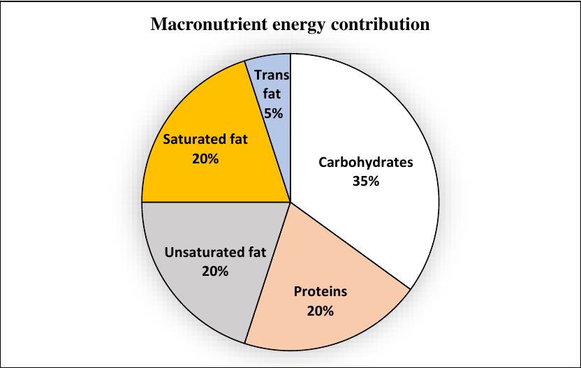

# 2024 CS1 Q8: Total fat in grams from a pie chart

## Question

The pie chart presents the percentage contribution of different macronutrients to a typical 2,000 kcal diet of a person.

The typical energy density (kcal/g) of these macronutrients is given in the table.

| Macronutrient | Energy density (kcal/g) |
|---|---|
| Carbohydrates | 4 |
| Proteins | 4 |
| Unsaturated fat | 9 |
| Saturated fat | 9 |
| Trans fat | 9 |

The total fat (all three types), in grams, this person consumes is

- (A) 44.4
- (B) 77.8
- (C) 100
- (D) 3,600

Answer

**C (100)**

Solution

**Fat share of energy:** unsaturated 20% + saturated 20% + trans 5% = **45%**.

**Energy from fat:** $0.45 \times 2000 = 900$ kcal.

**Convert to grams** at 9 kcal/g:

$$\frac{900}{9} = 100 \text{ g}.$$

**Why the others fail:** 44.4 g is $400/9$ (using only 20%). 77.8 g is $700/9$ (using 35%, the carbohydrate share). 3,600 multiplies by 4 and by 2000 wrongly.

**Key idea:** percent of energy → kcal → grams (divide by energy density).

