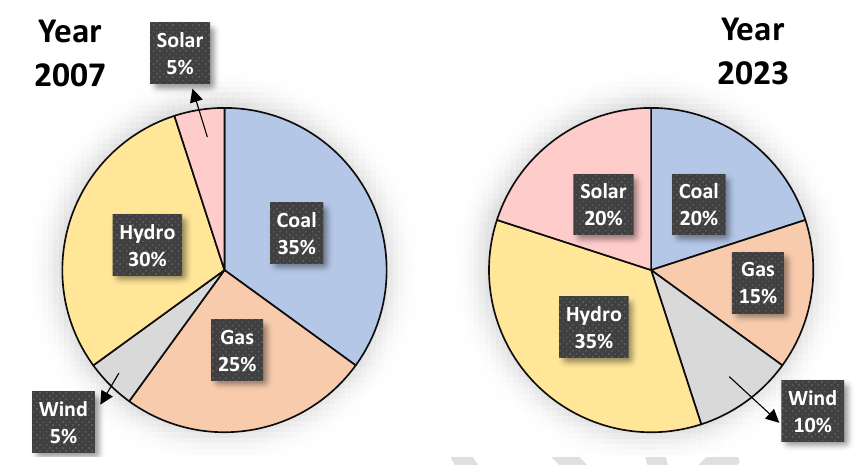

# 2024 CS2 Q8: Percentage increase in renewable share

## Question

The pie charts depict the shares of various power generation technologies in the total electricity generation of a country for the years 2007 and 2023.

The renewable sources of electricity generation consist of Hydro, Solar and Wind. Assuming that the total electricity generated remains the same from 2007 to 2023, what is the percentage increase in the share of the renewable sources of electricity generation over this period?

- (A) 25%
- (B) 50%
- (C) 77.5%
- (D) 62.5%

Answer

**D (62.5%)**

Solution

| Source | 2007 | 2023 |
|---|---|---|
| Hydro | 30 | 35 |
| Solar | 5 | 20 |
| Wind | 5 | 10 |
| **Renewable** | **40** | **65** |

$$\text{Increase} = \frac{65 - 40}{40} \times 100 = 62.5\%.$$

**Why the others fail:** 25% is the *difference in percentage points*. 50% and 77.5% come from adding or dividing the wrong columns.

**Key idea:** a percentage increase is relative to the old value, not the 100 total.

