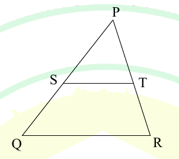

# 2025 CS1 Q7: Area ratio of a triangle to the trapezium below it

## Question

In the diagram, the lines QR and ST are parallel to each other. The shortest distance between these two lines is half the shortest distance between the point P and line QR. What is the ratio of the area of the triangle PST to the area of the trapezium SQRT?

Note: The figure shown is representative.

- (A) $\dfrac{1}{3}$
- (B) $\dfrac{1}{4}$
- (C) $\dfrac{2}{5}$
- (D) $\dfrac{1}{2}$

Answer

**A**

Solution

Let the distance from P to QR be $2h$. The distance between ST and QR is $h$ (half of $2h$), so the distance from P to ST is also $h$.

Since $ST \parallel QR$, triangle $PST$ is similar to triangle $PQR$, with ratio of heights

$$\frac{h}{2h} = \frac{1}{2}.$$

Areas of similar triangles scale as the square of the ratio:

$$\frac{[PST]}{[PQR]} = \frac{1}{4}.$$

The trapezium is what remains of $PQR$ after removing $PST$:

$$[SQRT] = [PQR] - [PST] = \frac{3}{4}[PQR].$$

$$\frac{[PST]}{[SQRT]} = \frac{1/4}{3/4} = \frac{1}{3}.$$

| Option | Note |
|---|---|
| B, $\frac14$ | This is $[PST]/[PQR]$, not the ratio to the trapezium |
| C, $\frac25$ and D, $\frac12$ | Do not follow from the similarity ratio $\frac12$ |

**Key idea:** area ratio of similar triangles is the square of the side ratio, so $\frac14$ and $\frac34$ give $\frac13$.

