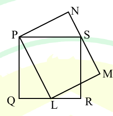

# 2025 CS2 Q9: Area of rectangle PLMN around a square

## Question

In the given figure, PQRS is a square of side 2 cm and PLMN is a rectangle. The corner L of the rectangle is on the side QR. Side MN of the rectangle passes through the corner S of the square.

What is the area (in cm$^2$) of the rectangle PLMN?

Note: The figure shown is representative.

- (A) $2\sqrt2$
- (B) $2$
- (C) $8$
- (D) $4$

Answer

**D**

Solution

Use the area of triangle $PLS$ in two ways.

**1. Using the rectangle.** $PL$ and $MN$ are opposite (parallel) sides of the rectangle, and $S$ lies on $MN$. So the distance from $S$ to line $PL$ equals the other side of the rectangle, $LM$. Hence

$$[PLS] = \tfrac12 \cdot PL \cdot LM = \tfrac12 \cdot (\text{area of rectangle}).$$

**2. Using the square.** Take $PS$ (the top side, length 2) as the base. $L$ lies on the bottom side $QR$, which is at distance 2 from $PS$, so

$$[PLS] = \tfrac12 \cdot 2 \cdot 2 = 2.$$

Therefore the area of the rectangle is $2 \times 2 = 4\ \text{cm}^2$.

The answer does not depend on where $L$ sits on $QR$.

**Key idea:** a triangle on the side of a rectangle with its apex on the opposite side has half the rectangle's area.

