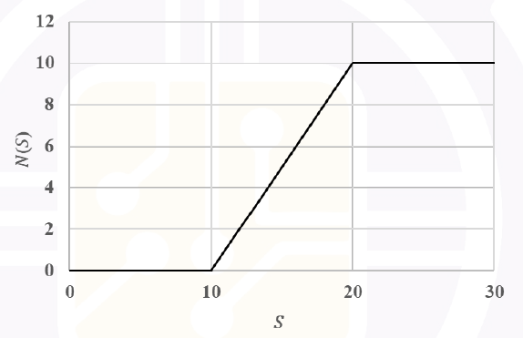

# 2026 CS1 Q8: Expressing a graph using hinge functions

## Question

For positive real numbers $S$ and $K$, the function $H_K(S)$ is defined as $H_K(S) = \max(S - K, 0)$. The max function is defined as

$$\max(a,b) = \begin{cases} a, & a > b \\ b, & a \le b \end{cases}$$

The graph below shows the plot of a function $N(S)$ versus $S$. $N(S)$ can be expressed as ________.

- (A) $H_{10}(S) - H_{20}(S)$
- (B) $H_{10}(S) - 2H_{20}(S)$
- (C) $-H_{10}(S) + H_{20}(S)$
- (D) $H_{15}(S) - H_{20}(S)$

Answer

**A**

Solution

**Read the graph.** $N = 0$ for $S \le 10$. It rises with slope 1 from $(10, 0)$ to $(20, 10)$. For $S \ge 20$ it stays at 10.

**What $H_K$ looks like.** $H_K(S)$ is 0 up to $K$, then rises with slope 1.

**Build it.** Start with $H_{10}(S)$ (slope 1 after 10). Subtract $H_{20}(S)$ so the slope drops back to 0 after 20.

| Range | $H_{10}$ | $H_{20}$ | $H_{10} - H_{20}$ |
|---|---|---|---|
| $S \le 10$ | 0 | 0 | 0 |
| $10 < S \le 20$ | $S-10$ | 0 | $S - 10$ |
| $S > 20$ | $S - 10$ | $S - 20$ | $10$ |

This matches the graph.

**Why the others fail:**

- (B) For $S > 20$: $(S-10) - 2(S-20) = 30 - S$, which keeps falling.
- (C) Always $\le 0$, but the graph is $\ge 0$.
- (D) $H_{15} - H_{20}$ starts rising at 15 and tops out at 5.

**Key idea:** subtracting a hinge $H_{b}$ cancels the slope of $H_a$ after $b$, giving a ramp that flattens.

