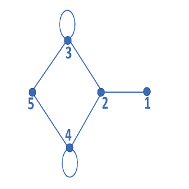

# 2023 CS Q30: Sum of eigenvalues of an adjacency matrix with loops

## Question

Let $A$ be the adjacency matrix of the graph with vertices $\lbrace 1, 2, 3, 4, 5 \rbrace$.

Let $\lambda_1, \lambda_2, \lambda_3, \lambda_4$, and $\lambda_5$ be the five eigenvalues of $A$. Note that these eigenvalues need not be distinct. The value of $\lambda_1 + \lambda_2 + \lambda_3 + \lambda_4 + \lambda_5 =$ ______.

Answer

**2 OR 4**

Solution

**Sum of eigenvalues = trace.** The trace is the sum of the diagonal entries.

**Diagonal entries.** The edges 1-2, 2-3, 2-4, 3-5, 4-5 give zeros on the diagonal. The self-loops at vertices 3 and 4 put entries on the diagonal.

- **Convention 1:** a loop adds 1 to its diagonal entry. Trace $= 1 + 1 = 2$.
- **Convention 2:** in an undirected graph a loop contributes 2 (its degree). Trace $= 2 + 2 = 4$.

The official key accepts **both 2 and 4**, since the question does not state which convention applies.

**Code check:** building the matrix with 1s on the diagonal and summing eigenvalues with NumPy gave 2.0. With 2s on the diagonal the trace is 4.

**Key idea:** $\sum \lambda_i = \operatorname{tr}(A)$, so no eigenvalue computation is needed.

