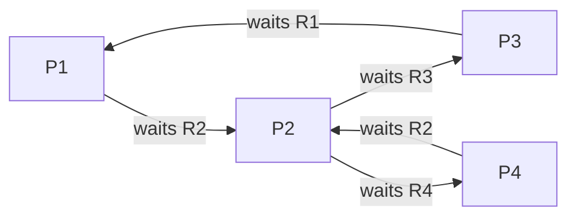

# 2025 CS2 Q48: Which aborts remove the deadlock

## Question

$P = \lbrace P_1, P_2, P_3, P_4\rbrace$ consists of all active processes in an operating system. $R = \lbrace R_1, R_2, R_3, R_4\rbrace$ consists of single instances of distinct types of resources in the system.

The resource allocation graph has the following assignment and claim edges.

- Assignment edges: $R_1 \to P_1$, $R_2 \to P_2$, $R_3 \to P_3$, $R_4 \to P_4$ (the assignment edge $R_1 \to P_1$ means resource $R_1$ is assigned to process $P_1$, and so on for others)
- Claim edges: $P_1 \to R_2$, $P_2 \to R_3$, $P_3 \to R_1$, $P_2 \to R_4$, $P_4 \to R_2$ (the claim edge $P_1 \to R_2$ means process $P_1$ is waiting for resource $R_2$, and so on for others)

Which of the following statement(s) is/are CORRECT?

- (A) Aborting $P_1$ makes the system deadlock free.
- (B) Aborting $P_3$ makes the system deadlock free.
- (C) Aborting $P_2$ makes the system deadlock free.
- (D) Aborting $P_1$ and $P_4$ makes the system deadlock free.

Answer

**C and D**

Solution

With single-instance resources, **a deadlock exists iff the graph has a cycle**. Who holds what, and who waits for what:

| Process | Holds | Waits for (held by) |
|---|---|---|
| $P_1$ | $R_1$ | $R_2$ ($P_2$) |
| $P_2$ | $R_2$ | $R_3$ ($P_3$) and $R_4$ ($P_4$) |
| $P_3$ | $R_3$ | $R_1$ ($P_1$) |
| $P_4$ | $R_4$ | $R_2$ ($P_2$) |

*Wait-for graph. There are two cycles: $P_1 \to P_2 \to P_3 \to P_1$ and $P_2 \to P_4 \to P_2$. Both pass through $P_2$.*

| Option | Effect | Verdict |
|---|---|---|
| A: abort $P_1$ | Breaks the first cycle but $P_2 \leftrightarrow P_4$ remains | Still deadlocked |
| B: abort $P_3$ | Breaks the first cycle but $P_2 \leftrightarrow P_4$ remains | Still deadlocked |
| **C: abort $P_2$** | $P_2$ is in **both** cycles, so both break. $R_2$ is freed and the others can finish | **Deadlock free** |
| **D: abort $P_1$ and $P_4$** | $P_1$ breaks the first cycle and $P_4$ breaks the second | **Deadlock free** |

I checked each case with a deadlock-detection simulation (repeatedly letting any process finish whose requests can be met): only aborting $P_2$, or $P_1$ together with $P_4$, lets every remaining process finish.

**Key idea:** a victim set must hit **every** cycle. A process in all cycles ($P_2$) does it alone.

