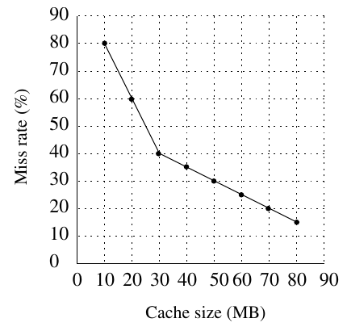

# 2016 CS2 Q50: Smallest cache size for average read latency below 6 ms

## Question

A file system uses an in-memory cache to cache disk blocks. The miss rate of the cache is shown in the figure. The latency to read a block from the cache is 1 ms and to read a block from the disk is 10 ms. Assume that the cost of checking whether a block exists in the cache is negligible. Available cache sizes are in multiples of 10 MB.

The smallest cache size required to ensure an average read latency of less than 6 ms is ______ MB.

Answer

**30**

Solution

With miss rate $m$ (a fraction), the average latency is

$$L = (1 - m)\cdot 1 + m \cdot 10 = 1 + 9m\ \text{ms}.$$

We need $L < 6$, so $m < 5/9 \approx 55.6\%$.

**Miss rates read from the figure.**

| Cache (MB) | Miss rate | Average latency (ms) |
|---|---|---|
| 10 | 80% | 8.2 |
| 20 | 60% | 6.4 |
| 30 | 40% | 4.6 |
| 40 | 35% | 4.15 |

At 20 MB the latency $6.4$ ms is not below $6$; at 30 MB it is $4.6$ ms. The smallest size is $30$ MB.

**Caveat.** The miss-rate values are read off the printed graph (the points at 20 MB and 30 MB are $60\%$ and $40\%$). The answer needs only that $20$ MB is above $55.6\%$ and $30$ MB below it.

**Code check:** the table above was computed by code from the same graph values.

**Key idea:** $L = 1 + 9m < 6$ needs miss rate below 55.6%, first true at 30 MB (40%).

