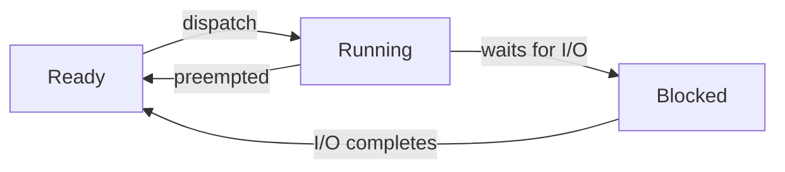

# 2020 CS Q22: Valid process state transitions under preemptive scheduling

## Question

Consider the following statements about process state transitions for a system using preemptive scheduling.

- I. A running process can move to ready state.
- II. A ready process can move to running state.
- III. A blocked process can move to running state.
- IV. A blocked process can move to ready state.

Which of the above statements are TRUE?

- (A) I, II, and III only
- (B) II and III only
- (C) I, II, and IV only
- (D) I, II, III, and IV

Answer

**C**

Solution

The process states and their transitions:

| Statement | Verdict | Reason |
|---|---|---|
| I. running to ready | **True** | The process is preempted, for example when its time slice ends. |
| II. ready to running | **True** | The scheduler dispatches it. |
| III. blocked to running | **False** | A blocked process whose I/O finishes first goes to *ready* and waits for the scheduler. It never goes straight to running. |
| IV. blocked to ready | **True** | The event it waited for has occurred. |

True: I, II and IV.

**Why the other options fail:** (A), (B) and (D) all include III.

**Key idea:** only the scheduler moves a process into the running state, and it only picks from the ready queue.

