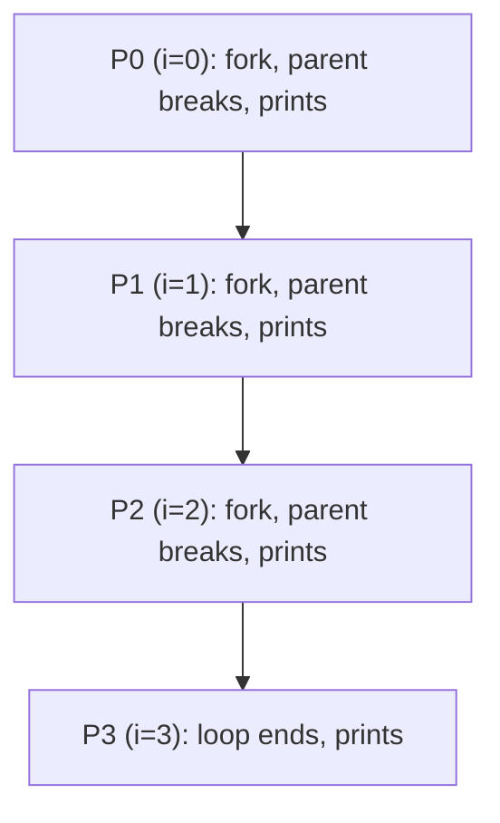

# 2026 CS1 Q63: Counting prints with fork() in a loop

## Question

Consider the following program. Assume it compiles and runs successfully, and `fork()` always succeeds.

```c
int main () {
   int i;
   for (i = 0; i < 3; i++){
      if (fork() == 0){
         continue;
      }
      break;
   }
   printf("Hello!");
   return 0;
}
```

The total number of times the `printf` statement gets executed is _____. (answer in integer)

<details class="success" markdown="1">
<summary>Answer</summary>

**4**

</details>

<details class="info" markdown="1">
<summary>Solution</summary>

**Refresher.** `fork()` returns 0 in the child and the child's pid (non-zero) in the parent.

**What the loop does.**

- In the **child** (`fork() == 0`): `continue`, so it goes on to the next iteration and may fork again.
- In the **parent** (non-zero): `break`, so it leaves the loop and prints.

So at every iteration the parent stops, and only the child continues. This builds a chain, not a tree.



| Process | Created at | What it does | Prints? |
|---|---|---|---|
| P0 | start | forks P1, then breaks | yes |
| P1 | $i=0$ | forks P2, then breaks | yes |
| P2 | $i=1$ | forks P3, then breaks | yes |
| P3 | $i=2$ | the loop ends at $i=3$ | yes |

Four processes in total, each printing once: **4**.

**Verified.** I compiled and ran the program: the output contained `Hello!` exactly 4 times.

**Key idea:** with `continue` in the child and `break` in the parent, each fork produces one new process, so a loop of 3 forks gives 4 processes (not $2^3 = 8$).

</details>
