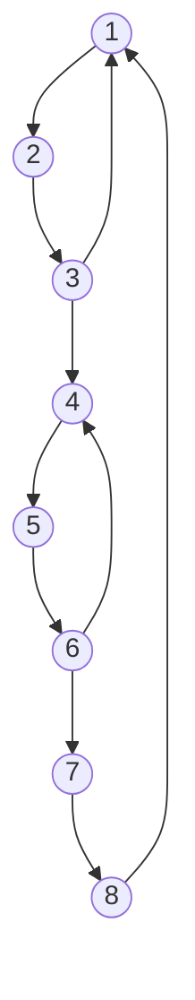

# Out of syllabus

The current GATE CS syllabus has no software engineering section. These 11 questions from GATE 2014 and 2015 are on that subject (process models, requirements, modular design, testing, metrics, estimation). They are kept here for completeness, with answers checked against the official key, but they are **not** part of any topic page or the by-year lists.

| Question | Theme | Official key |
|---|---|---|
| 2014 CS1 Q18 | Software process models | B |
| 2014 CS2 Q19 | Requirements engineering | C |
| 2014 CS3 Q19 | Modular design (cohesion and coupling) | B |
| 2015 CS1 Q16 | Software testing and metrics | C |
| 2015 CS1 Q38 | Software testing and metrics | 5 |
| 2015 CS2 Q25 | Software process and estimation | C |
| 2015 CS2 Q29 | Software process and estimation | A |
| 2015 CS2 Q64 | Software testing and metrics | C |
| 2015 CS3 Q17 | Software process and estimation | 612 to 613 |
| 2015 CS3 Q33 | Software testing and metrics | 28 |
| 2015 CS3 Q58 | Software testing and metrics | A |

## 2014 CS1 Q18: Match process models with features

*CS1 · 1 mark · MCQ · official key: B · status: verified*

**Question**

Match the following:

| Model | Feature |
|---|---|
| 1) Waterfall model | a) Specifications can be developed incrementally |
| 2) Evolutionary model | b) Requirements compromises are inevitable |
| 3) Component-based software engineering | c) Explicit recognition of risk |
| 4) Spiral development | d) Inflexible partitioning of the project into stages |

- (A) 1-a, 2-b, 3-c, 4-d
- (B) 1-d, 2-a, 3-b, 4-c
- (C) 1-d, 2-b, 3-a, 4-c
- (D) 1-c, 2-a, 3-b, 4-d

<details class="success" markdown="1">
<summary>Answer</summary>

**B**

</details>

<details class="info" markdown="1">
<summary>Solution</summary>

This is textbook software engineering (Sommerville).

- **Waterfall** splits the project into fixed stages: **d**.
- **Evolutionary** development builds specification and software together in versions: **a**.
- **Component-based** development reuses existing components, so requirements must be compromised to fit them: **b**.
- **Spiral** adds risk analysis to each loop: **c**.

That is 1-d, 2-a, 3-b, 4-c.

- (A) gives Waterfall incremental specifications, the opposite of its fixed stages.
- (C) swaps Evolutionary and Component-based.
- (D) gives Waterfall risk recognition. Waterfall has none.

**Key idea:** waterfall rigid, evolutionary incremental, component-based compromises, spiral risk.

</details>

## 2014 CS2 Q19: Which statement about requirements is TRUE

*CS2 · 1 mark · MCQ · official key: C · status: verified*

**Question**

Which one of the following is TRUE?

- (A) The requirements document also describes how the requirements that are listed in the document are implemented efficiently.
- (B) Consistency and completeness of functional requirements are always achieved in practice.
- (C) Prototyping is a method of requirements validation.
- (D) Requirements review is carried out to find the errors in system design.

<details class="success" markdown="1">
<summary>Answer</summary>

**C**

</details>

<details class="info" markdown="1">
<summary>Solution</summary>

**Prototyping** lets users try a working model, which checks that the requirements describe what they want. It is a standard requirements-validation technique, alongside reviews and test-case generation.

- (A) a requirements document says *what* the system must do, not *how* to implement it. That belongs to design.
- (B) consistency and completeness are goals, and in practice they are hard to reach in full.
- (D) a requirements review looks for errors in the *requirements*, not in the design.

**Key idea:** requirements validation methods are reviews, prototyping and test-case generation.

</details>

## 2014 CS3 Q19: Desirable cohesion and coupling in modular design

*CS3 · 1 mark · MCQ · official key: B · status: verified*

**Question**

In the context of modular software design, which one of the following combinations is desirable?

- (A) High cohesion and high coupling
- (B) High cohesion and low coupling
- (C) Low cohesion and high coupling
- (D) Low cohesion and low coupling

<details class="success" markdown="1">
<summary>Answer</summary>

**B**

</details>

<details class="info" markdown="1">
<summary>Solution</summary>

- **Cohesion** is how closely the elements inside one module belong together (a single, focused purpose). Higher is better.
- **Coupling** is how strongly one module depends on others. Lower is better, since a change in one module then affects fewer others.

So the desirable combination is **high cohesion, low coupling**: **B**.

- (A) high coupling makes modules hard to change or reuse.
- (C) is the worst combination.
- (D) low cohesion means each module does unrelated things.

**Key idea:** good modular design is high cohesion within modules and low coupling between modules.

</details>

## 2015 CS1 Q16: Matching testing techniques with their categories

*CS1 · 1 mark · MCQ · official key: C · status: verified*

**Question**

Match the following:

| Technique | Category |
|---|---|
| (P) Condition coverage | (i) Black-box testing |
| (Q) Equivalence class partitioning | (ii) System testing |
| (R) Volume testing | (iii) White-box testing |
| (S) Alpha testing | (iv) Performance testing |

- (A) P-ii, Q-iii, R-i, S-iv
- (B) P-iii, Q-iv, R-ii, S-i
- (C) P-iii, Q-i, R-iv, S-ii
- (D) P-iii, Q-i, R-ii, S-iv

<details class="success" markdown="1">
<summary>Answer</summary>

**C**

</details>

<details class="info" markdown="1">
<summary>Solution</summary>

- **P, condition coverage: (iii) white-box.** It needs the code: every condition must take both true and false.
- **Q, equivalence class partitioning: (i) black-box.** Inputs are split into classes from the specification, with no look at the code.
- **R, volume testing: (iv) performance testing.** It runs the system with large amounts of data to see how it copes, which is a performance concern.
- **S, alpha testing: (ii) system testing.** It is done on the whole system by users or in-house testers at the developer's site, before release.

P-iii, Q-i, R-iv, S-ii: option (C).

- (A) starts with P-ii, but condition coverage is white-box.
- (B) has Q-iv, but equivalence partitioning is black-box.
- (D) has R-ii, but volume testing is about performance.

**Note.** Alpha testing is also described as a kind of acceptance testing. This question matches it with system testing, which is the only fit among the four labels.

**Key idea:** white-box techniques use the code (coverage). Black-box ones use the specification (partitioning). Volume and stress testing are performance tests.

</details>

## 2015 CS1 Q38: Cyclomatic complexity of a binary search loop

*CS1 · 2 marks · NAT · official key: 5 · status: verified*

**Question**

Consider the following C program segment.

```c
while (first <= last)
{
    if (array[middle] < search)
        first = middle + 1;
    else if (array[middle] == search)
        found = TRUE;
    else last = middle - 1;
    middle = (first + last) / 2;
}
if (first > last) notPresent = TRUE;
```

The cyclomatic complexity of the program segment is ________

<details class="success" markdown="1">
<summary>Answer</summary>

**5**

</details>

<details class="info" markdown="1">
<summary>Solution</summary>

McCabe's measure: $M = P + 1$, where $P$ is the number of **decision points** (binary predicates).

| Decision | Count |
|---|---|
| `while (first <= last)` | 1 |
| `if (array[middle] < search)` | 1 |
| `else if (array[middle] == search)` | 1 |
| `if (first > last)` | 1 |

$P = 4$, so $M = 4 + 1 = \mathbf{5}$.

The final `else` (`last = middle - 1`) is not a decision of its own: it is the false branch of the `else if`.

**Answer: 5.**

**Code check:** a control-flow graph of this segment (entry node, the loop and branch nodes, the assignments, and the exit) has $E = 14$ edges and $N = 11$ nodes, so $E - N + 2 = 5$, the same as $P + 1$.

**Key idea:** cyclomatic complexity $= E - N + 2 =$ number of decisions $+ 1$.

</details>

## 2015 CS2 Q25: What a software requirements specification should avoid

*CS2 · 1 mark · MCQ · official key: C · status: verified*

**Question**

A software requirements specification (SRS) document should avoid discussing which one of the following?

- (A) User interface issues
- (B) Non-functional requirements
- (C) Design specification
- (D) Interfaces with third party software

<details class="success" markdown="1">
<summary>Answer</summary>

**C**

</details>

<details class="info" markdown="1">
<summary>Solution</summary>

An SRS says **what** the system must do, not **how** it will be built. Design belongs in a separate design document.

- (A) User interface issues are a normal part of an SRS, as requirements on how users interact with the system.
- (B) Non-functional requirements (performance, security, reliability) are a standard SRS section.
- (D) Interfaces with third-party software are external interface requirements, also standard.
- **(C) Design specification** is the odd one out: it fixes the solution, which the SRS should leave open.

Option (C).

**Key idea:** requirements (the *what*) go in the SRS. Design (the *how*) does not.

</details>

## 2015 CS2 Q29: Form of the basic COCOMO equations

*CS2 · 1 mark · MCQ · official key: A · status: verified*

**Question**

Consider the basic COCOMO model where $E$ is the effort applied in person-months, $D$ is the development time in chronological months, $KLOC$ is the estimated number of delivered lines of code (in thousands) and $a_b, b_b, c_b, d_b$ have their usual meanings. The basic COCOMO equations are of the form

- (A) $E = a_b\,(KLOC)\,\exp(b_b)$, $D = c_b\,(E)\,\exp(d_b)$
- (B) $D = a_b\,(KLOC)\,\exp(b_b)$, $E = c_b\,(D)\,\exp(d_b)$
- (C) $E = a_b\,\exp(b_b)$, $D = c_b\,(KLOC)\,\exp(d_b)$
- (D) $E = a_b\,\exp(d_b)$, $D = c_b\,(KLOC)\,\exp(b_b)$

<details class="success" markdown="1">
<summary>Answer</summary>

**A**

</details>

<details class="info" markdown="1">
<summary>Solution</summary>

Basic COCOMO has two steps:

1. **Effort** from size: $E = a_b \,(KLOC)^{b_b}$ person-months.
2. **Time** from effort: $D = c_b \,(E)^{d_b}$ months.

For example, for the organic mode: $a_b = 2.4$, $b_b = 1.05$, $c_b = 2.5$, $d_b = 0.38$.

Here $x\,\exp(y)$ in the options means "$x$ raised to the power $y$". Option (A) then reads $E = a_b (KLOC)^{b_b}$, $D = c_b (E)^{d_b}$, which is the model.

- (B) reverses the roles: development time is computed *from* effort, not the other way round.
- (C) and (D) make effort independent of size ($E$ has no $KLOC$) and time depend on $KLOC$ directly.

**Note.** The options print the power as "exp(...)". If it were read as $e^{(\cdot)}$, no option would be a valid model, so I follow the key and the power reading.

**Key idea:** basic COCOMO is two power laws: $E = a(KLOC)^b$, then $D = cE^d$.

</details>

## 2015 CS2 Q64: True statement about code inspection and walkthrough

*CS2 · 2 marks · MCQ · official key: C · status: verified*

**Question**

Which one of the following assertions concerning code inspection and code walkthrough is true?

- (A) Code inspection is carried out once the code has been unit tested
- (B) Code inspection and code walkthrough are synonyms
- (C) Adherence to coding standards is checked during code inspection
- (D) Code walkthrough is usually carried out by an independent test team

<details class="success" markdown="1">
<summary>Answer</summary>

**C**

</details>

<details class="info" markdown="1">
<summary>Solution</summary>

Both are static reviews of code (the code is read, not run), but they differ.

| | Inspection | Walkthrough |
|---|---|---|
| Style | Formal, led by a moderator | Informal |
| Led by | Trained inspectors | The author |
| Uses | Checklists, coding standards | Author explains the code |

- (A) is false: inspection is done on the code as a static review, not only after unit testing.
- (B) is false: they are different techniques.
- **(C) is true:** inspection works from checklists, and checking coding standards is a typical item.
- (D) is false: a walkthrough is run by the author with peers, not by an independent test team.

Option (C).

**Key idea:** inspection is a formal, checklist-driven review (including coding standards). A walkthrough is an informal, author-led review.

</details>

## 2015 CS3 Q17: Function point count with value adjustment factors

*CS3 · 1 mark · NAT · official key: 612 to 613 · status: verified*

**Question**

Consider a software project with the following information domain characteristics for calculation of function point metric.

| Characteristic | Count |
|---|---|
| Number of external inputs ($I$) | 30 |
| Number of external outputs ($O$) | 60 |
| Number of external inquiries ($E$) | 23 |
| Number of files ($F$) | 08 |
| Number of external interfaces ($N$) | 02 |

It is given that the complexity weighting factors for $I$, $O$, $E$, $F$ and $N$ are 4, 5, 4, 10 and 7, respectively. It is also given that, out of fourteen value adjustment factors that influence the development effort, four factors are not applicable, each of the other four factors have value 3, and each of the remaining factors have value 4. The computed value of function point metric is ________

<details class="success" markdown="1">
<summary>Answer</summary>

**612.06**

</details>

<details class="info" markdown="1">
<summary>Solution</summary>

$FP = UFP \times VAF$.

**Unadjusted function points:**

| | Count | Weight | Product |
|---|---|---|---|
| $I$ | 30 | 4 | 120 |
| $O$ | 60 | 5 | 300 |
| $E$ | 23 | 4 | 92 |
| $F$ | 8 | 10 | 80 |
| $N$ | 2 | 7 | 14 |
| **UFP** | | | **606** |

**Value adjustment factor.** There are 14 factors:

- 4 not applicable: value $0$ each, total $0$
- 4 with value 3: total $12$
- the remaining $14 - 4 - 4 = 6$ with value 4: total $24$

$\sum F_i = 36$, so

$$VAF = 0.65 + 0.01 \times 36 = 1.01$$

$$FP = 606 \times 1.01 = 612.06$$

**Answer: 612.06**, which lies in the key's range "612 to 613".

**Code check:** the arithmetic above gives UFP $= 606$, $\sum F_i = 36$, $FP = 612.06$.

**Key idea:** $FP = UFP \times (0.65 + 0.01 \sum F_i)$. A factor that does not apply is rated 0.

</details>

## 2015 CS3 Q33: Estimating undetected real faults from fault seeding

*CS3 · 1 mark · NAT · official key: 28 · status: verified*

**Question**

Consider a software program that is artificially seeded with 100 faults. While testing this program, 159 faults are detected, out of which 75 faults are from those artificially seeded faults. Assuming that both real and seeded faults are of same nature and have same distribution, the estimated number of undetected real faults is ________

<details class="success" markdown="1">
<summary>Answer</summary>

**28**

</details>

<details class="info" markdown="1">
<summary>Solution</summary>

**Fault seeding.** Testing finds seeded and real faults at the same rate, so the seeded detection rate estimates the real one.

- Seeded faults found: $75$ of $100$, a detection rate of $0.75$.
- Real faults found: $159 - 75 = 84$.

If $84$ is $75\%$ of all real faults:

$$\text{Total real faults} = \frac{84}{0.75} = 112$$

$$\text{Undetected real faults} = 112 - 84 = \mathbf{28}$$

**Answer: 28.**

**Code check:** $84 \times 100/75 = 112$ and $112 - 84 = 28$.

**Key idea:** $\dfrac{\text{seeded found}}{\text{seeded total}} = \dfrac{\text{real found}}{\text{real total}}$.

</details>

## 2015 CS3 Q58: McCabe cyclomatic complexity of three programs

*CS3 · 2 marks · MCQ · official key: A · status: verified*

**Question**

Consider three software items: Program-X, Control Flow Diagram of Program-Y and Control Flow Diagram of Program-Z as shown below.


The values of McCabe's cyclomatic complexity of Program-X, Program-Y, and Program-Z respectively are

- (A) 4, 4, 7
- (B) 3, 4, 7
- (C) 4, 4, 8
- (D) 4, 3, 8

<details class="success" markdown="1">
<summary>Answer</summary>

**A**

</details>

<details class="info" markdown="1">
<summary>Solution</summary>

**Program-X.** Count the decisions, treating each `if` or `while` as **one** decision (even though the `while` has an `AND`):

- `if (value < 0)`
- `while (...)`
- `if (result <= maxint)`

$P = 3$, so $M = P + 1 = \mathbf{4}$.

**Program-Y.** Read the graph: 8 nodes in a chain, so 7 edges, plus 3 back edges (node 3 to 1, node 6 to 4, node 8 to 1):

$$E = 10,\quad N = 8,\quad M = E - N + 2 = 10 - 8 + 2 = \mathbf{4}$$



**Program-Z.** X followed by Y in sequence. Joining two graphs with one edge gives

$$M_Z = M_X + M_Y - 1 = 4 + 4 - 1 = \mathbf{7}$$

So 4, 4, 7: option (A).

- (B) has 3 for X: it forgets the $+1$.
- (C) has 8 for Z: it adds $4 + 4$ without subtracting 1.
- (D) has both errors.

**Convention.** If the `AND` in the `while` were counted as two separate decisions (short-circuit evaluation), X would be 5 and Z 8, and no option would match. The key counts a compound condition as one decision.

**Code check:** edge-and-node counts for X (11 edges, 9 nodes), Y (10, 8) and Z (X, one joining edge, then Y) give 4, 4 and 7. Splitting the `AND` gives X $= 5$.

**Key idea:** $M = E - N + 2 = $ decisions $+ 1$. For two programs in sequence, $M = M_1 + M_2 - 1$.

</details>
