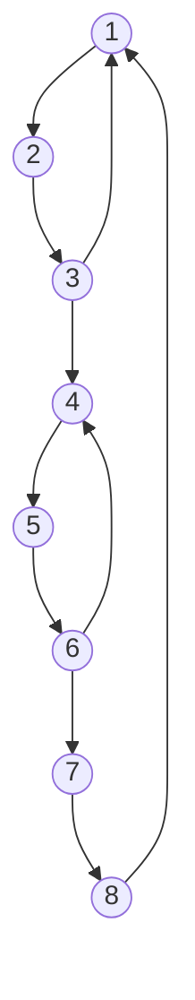

# Out of syllabus

The current GATE CS syllabus has no software engineering section, no numerical methods topic and no HTML markup topic. These 26 questions from GATE 2009, 2010, 2011, 2012, 2013, 2014 and 2015 are on those subjects (numerical methods, service-oriented computing, process models, requirements, modular design, testing, metrics, estimation, data flow diagrams, HTML tables). They are kept here for completeness, with answers checked against the official key where the key gives one, but they are **not** part of any topic page or the by-year lists.

| Question | Theme | Official key |
|---|---|---|
| 2009 CS Q19 | Modular design (types of coupling) | A |
| 2009 CS Q20 | HTML tables (rowspan and colspan) | none (blank in key) |
| 2009 CS Q49 | Data flow diagrams | C |
| 2009 CS Q50 | Cyclomatic complexity | B |
| 2010 CS Q2 | Newton-Raphson method (numerical methods) | D |
| 2010 CS Q21 | Cyclomatic complexity of modules in sequence | A |
| 2010 CS Q22 | Software life cycle activities | B |
| 2010 CS Q44 | Statement coverage (testing) | D |
| 2011 CS Q5 | Software cost estimation (break-even size) | B |
| 2011 CS Q7 | Basic COCOMO effort estimate | A |
| 2011 CS Q10 | Contents of a software requirement specification | D |
| 2011 CS Q47 | Black box testing (equivalence class partitioning) | C |
| 2012 CS Q28 | Bisection method (numerical methods) | B |
| 2013 CS Q11 | Service-oriented computing and web services | C |
| 2013 CS Q38 | Modular design (cohesion and coupling) | A |
| 2014 CS1 Q18 | Software process models | B |
| 2014 CS2 Q19 | Requirements engineering | C |
| 2014 CS3 Q19 | Modular design (cohesion and coupling) | B |
| 2015 CS1 Q16 | Software testing and metrics | C |
| 2015 CS1 Q38 | Software testing and metrics | 5 |
| 2015 CS2 Q25 | Software process and estimation | C |
| 2015 CS2 Q29 | Software process and estimation | A |
| 2015 CS2 Q64 | Software testing and metrics | C |
| 2015 CS3 Q17 | Software process and estimation | 612 to 613 |
| 2015 CS3 Q33 | Software testing and metrics | 28 |
| 2015 CS3 Q58 | Software testing and metrics | A |

## 2009 CS Q19: Ranking types of coupling from strongest to weakest

*CS · 1 mark · MCQ · official key: A · status: verified*

**Question**

The coupling between different modules of a software is categorized as follows:

- I. Content coupling
- II. Common coupling
- III. Control coupling
- IV. Stamp coupling
- V. Data coupling

Coupling between modules can be ranked in the order of strongest (least desirable) to weakest (most desirable) as follows:

- (A) I - II - III - IV - V
- (B) V - IV - III - II - I
- (C) I - III - V - II - IV
- (D) IV - II - V - III - I

<details class="success" markdown="1">
<summary>Answer</summary>

**A**

</details>

<details class="info" markdown="1">
<summary>Solution</summary>

From strongest to weakest, the standard ranking is:

1. **Content coupling:** one module uses or changes the inside (code or data) of another.
2. **Common coupling:** modules share global data.
3. **Control coupling:** one module passes a flag that controls the logic of another.
4. **Stamp coupling:** modules pass a whole data structure although only part of it is needed.
5. **Data coupling:** modules pass only the data items that are needed, as parameters.

That is I - II - III - IV - V: (A).

- (B) is exactly the reverse order, weakest to strongest.
- (C) and (D) put common, control or stamp coupling in the wrong places; for example (D) starts with stamp coupling, which is one of the weaker kinds.

**Classification note:** modular design (coupling and cohesion) is software engineering, which is not in the current syllabus.

**Key idea:** the more a module depends on the inside of another (content, then common), the stronger and worse the coupling; plain data parameters are the weakest and best.

</details>

## 2009 CS Q20: Rows per column and columns per row of an HTML table

*CS · 1 mark · MCQ · official key: none (blank in key) · status: unverified*

**Question**

Consider the HTML table definition given below:

```html
<table border=1>
<tr> <td rowspan=2> ab </td>
     <td colspan=2> cd </td>
</tr>
<tr> <td> ef </td>
     <td rowspan=2> gh </td>
</tr>
<tr> <td colspan=2> ik </td>
</tr>
</table>
```

The number of rows in each column and the number of columns in each row are:

- (A) ⟨2, 2, 3⟩ and ⟨2, 3, 2⟩
- (B) ⟨2, 2, 3⟩ and ⟨2, 2, 3⟩
- (C) ⟨2, 3, 2⟩ and ⟨2, 3, 2⟩
- (D) ⟨2, 3, 2⟩ and ⟨2, 2, 3⟩

<details class="success" markdown="1">
<summary>Answer</summary>

**C** (my answer; the supplied key leaves Q20 blank)

</details>

<details class="info" markdown="1">
<summary>Solution</summary>

**Official key:** the key table in the supplied PDF has no entry for Q20, so I cannot check against it. The answer below is my own reading.

Lay the cells out on a grid. Each cell goes in the first free slot of its row, and a `rowspan` cell blocks its slot in the rows below:

| | Column 1 | Column 2 | Column 3 |
|---|---|---|---|
| Row 1 | ab | cd | cd |
| Row 2 | ab | ef | gh |
| Row 3 | ik | ik | gh |

- `ab` has `rowspan=2`, so it fills column 1 in rows 1 and 2.
- `cd` has `colspan=2`, so it fills columns 2 and 3 of row 1.
- In row 2, column 1 is taken by `ab`, so `ef` goes to column 2 and `gh` to column 3. `gh` has `rowspan=2`, so it also takes column 3 of row 3.
- In row 3, only columns 1 and 2 are free, and `ik` (`colspan=2`) fills them.

Now count the **cells** (the `td` elements) that appear in each column and in each row:

- Per column: column 1 has `ab`, `ik` (2); column 2 has `cd`, `ef`, `ik` (3); column 3 has `cd`, `gh` (2). That is $\langle 2, 3, 2 \rangle$.
- Per row: row 1 has `ab`, `cd` (2); row 2 has `ab`, `ef`, `gh` (3); row 3 has `ik`, `gh` (2). That is $\langle 2, 3, 2 \rangle$.

So the answer is (C).

- (A), (B), (D) each give $\langle 2, 2, 3 \rangle$ for one of the two counts, which does not match either count above.

**Status note:** marked `unverified` because the key gives no answer and the question is open to a reading. If "rows in each column" is read as the number of grid squares, every column has $3$ and every row has $3$, giving $\langle 3, 3, 3 \rangle$ for both, which is not an option. Only the count of distinct cells matches an option. A small program laid out the table and gave per-column $[2, 3, 2]$ and per-row $[2, 3, 2]$ distinct cells, and $[3, 3, 3]$ grid squares per column.

**Classification note:** HTML table markup is not part of the current syllabus.

**Key idea:** place `rowspan` and `colspan` cells on a grid first, then count the distinct cells in each column and row.

</details>

## 2009 CS Q49: True statements about data flow diagrams

*CS · 2 marks · MCQ · official key: C · status: verified*

**Question**

Which of the following statements are TRUE?

- I. The context diagram should depict the system as a single bubble.
- II. External entities should be identified clearly at all levels of DFDs.
- III. Control information should not be represented in a DFD.
- IV. A data store can be connected either to another data store or to an external entity.

Options:

- (A) II and III
- (B) I, II and IV
- (C) I and III
- (D) I, II and III

<details class="success" markdown="1">
<summary>Answer</summary>

**C**

</details>

<details class="info" markdown="1">
<summary>Solution</summary>

- **I. True.** The context diagram (level 0) shows the whole system as one bubble, with the external entities around it.
- **II. False (judgement call).** External entities are drawn on the context diagram and the top level. When a process is exploded into lower levels, the sources and sinks are not required to be repeated at every level; what must stay consistent is the data flows into and out of the exploded process. The official key treats II as false, and I follow it.
- **III. True.** A DFD shows the flow of **data** between processes, stores and entities. Control information (such as signals or the order of execution) belongs in other models, not in a DFD.
- **IV. False.** Data does not move by itself. A data store can be connected only to processes, so a flow from one store to another store, or between a store and an external entity, is not allowed.

True: I and III, so (C).

- (A) and (D) contain II. (B) contains II and IV.

**Classification note:** data flow diagrams belong to structured analysis in software engineering, which is not in the current syllabus.

**Key idea:** a context diagram is one bubble, DFDs carry data and not control, and data stores connect only to processes.

</details>

## 2009 CS Q50: Statements about cyclomatic complexity

*CS · 2 marks · MCQ · official key: B · status: verified*

**Question**

Consider the following statements about the cyclomatic complexity of the control flow graph of a program module. Which of these are TRUE?

- I. The cyclomatic complexity of a module is equal to the maximum number of linearly independent circuits in the graph.
- II. The cyclomatic complexity of a module is the number of decisions in the module plus one, where a decision is effectively any conditional statement in the module.
- III. The cyclomatic complexity can also be used as a number of linearly independent paths that should be tested during path coverage testing.

Options:

- (A) I and II
- (B) II and III
- (C) I and III
- (D) I, II and III

<details class="success" markdown="1">
<summary>Answer</summary>

**B**

</details>

<details class="info" markdown="1">
<summary>Solution</summary>

For a control flow graph with $E$ edges and $N$ nodes (one entry, one exit), $V(G) = E - N + 2$.

- **II is true.** $V(G)$ equals the number of decision points plus one. Two sequential `if`s give $V(G) = 3$.
- **III is true.** $V(G)$ is the number of linearly independent paths through the module, so it is the number of paths a basis-path test set must cover.
- **I is false as written.** The flow graph itself has $E - N + 1 = V(G) - 1$ independent circuits. McCabe's count of $V(G)$ circuits is for the graph made strongly connected by adding an edge from the exit back to the entry. So "the number of independent circuits in the graph" is one less than $V(G)$ for the flow graph.

True: II and III, so (B).

- (A), (C), (D) all contain I.

**Judgement call:** statement I is true if "the graph" is read as the strongly connected graph with the return edge. The key treats it as false, which is the reading for the flow graph as drawn, and I follow the key.

**Code check:** a program counted these for small graphs. For the flow graph of one `if-else` ($4$ edges, $4$ nodes): $V(G) = 2$ and $1$ independent circuit. With the exit-to-entry edge added ($5$ edges): $2$ independent circuits. For two sequential `if`s ($8$ edges, $7$ nodes): $V(G) = 3$, which is decisions plus one.

**Classification note:** cyclomatic complexity is a software metric, which is not in the current syllabus.

**Key idea:** $V(G) = \text{decisions} + 1 = E - N + 2$, and it counts the independent paths to test.

</details>

## 2010 CS Q2: One Newton-Raphson iteration for the root of x² − 13

*CS · 1 mark · MCQ · official key: D · status: verified*

**Question**

Newton-Raphson method is used to compute a root of the equation $x^2 - 13 = 0$ with $3.5$ as the initial value. The approximation after one iteration is

- (A) 3.575
- (B) 3.676
- (C) 3.667
- (D) 3.607

<details class="success" markdown="1">
<summary>Answer</summary>

**D**

</details>

<details class="info" markdown="1">
<summary>Solution</summary>

The update is $x_1 = x_0 - \dfrac{f(x_0)}{f'(x_0)}$ with $f(x) = x^2 - 13$ and $f'(x) = 2x$.

$$x_1 = 3.5 - \frac{3.5^2 - 13}{2 \times 3.5} = 3.5 - \frac{-0.75}{7} = 3.5 + 0.10714 = 3.60714$$

So $x_1 \approx 3.607$: (D).

- (A) $3.575$, (B) $3.676$ and (C) $3.667$ are not what the formula gives. For a check, $\sqrt{13} \approx 3.6056$, and $3.607$ is the closest to it.

**Code check:** Python gave $x_1 = 3.607142857\ldots$

**Classification note:** this is a pure numerical-methods computation, like the 2012 bisection question below, so it is filed here. The repo does file a 2014 Newton-Raphson question under calculus, but that one asks about the convergence behaviour of the method on a cubic, not a one-step computation.

**Key idea:** one Newton-Raphson step is $x_1 = x_0 - f(x_0)/f'(x_0)$.

</details>

## 2010 CS Q21: Cyclomatic complexity of two modules joined in sequence

*CS · 1 mark · MCQ · official key: A · status: verified*

**Question**

The cyclomatic complexity of each of the modules A and B shown below is $10$. What is the cyclomatic complexity of the sequential integration shown on the right hand side?


- (A) 19
- (B) 21
- (C) 20
- (D) 10

<details class="success" markdown="1">
<summary>Answer</summary>

**A**

</details>

<details class="info" markdown="1">
<summary>Solution</summary>

Use $M = E - N + 2$ for a flow graph with $E$ edges and $N$ nodes. For A and B, $M = 10$ means $E - N = 8$ for each.

Join them in sequence: the exit of A is linked to the entry of B. Nothing else changes, so

$$M = (E_A + E_B + 1) - (N_A + N_B) + 2 = (E_A - N_A) + (E_B - N_B) + 3 = 8 + 8 + 3 = 19.$$

Equivalently, $M = \text{decisions} + 1$: A has $9$ decisions, B has $9$, and joining them adds none, so $M = 18 + 1 = 19$.

So $M = M_A + M_B - 1 = 19$: (A).

- (C) $20$ is $M_A + M_B$ and misses the $-1$.
- (B) $21$ and (D) $10$ do not follow from the formula.

**Code check:** two flow graphs with $M = 10$ each (a chain of $9$ if-else diamonds) were joined by one edge, giving $M = 19$. Merging A's exit node with B's entry node instead also gives $19$.

**Key idea:** for modules in sequence, $M = M_1 + M_2 - 1$.

</details>

## 2010 CS Q22: Software life cycle activities and their pairing

*CS · 1 mark · MCQ · official key: B · status: verified*

**Question**

What is the appropriate pairing of items in the two columns listing various activities encountered in a software life cycle?

| Activity | Description |
|---|---|
| P. Requirements Capture | 1. Module Development and Integration |
| Q. Design | 2. Domain Analysis |
| R. Implementation | 3. Structural and Behavioral Modeling |
| S. Maintenance | 4. Performance Tuning |

- (A) P-3, Q-2, R-4, S-1
- (B) P-2, Q-3, R-1, S-4
- (C) P-3, Q-2, R-1, S-4
- (D) P-2, Q-3, R-4, S-1

<details class="success" markdown="1">
<summary>Answer</summary>

**B**

</details>

<details class="info" markdown="1">
<summary>Solution</summary>

- **P, requirements capture: 2, domain analysis.** Capturing requirements starts by understanding the application domain.
- **Q, design: 3, structural and behavioural modelling.** Design models the structure and behaviour of the system.
- **R, implementation: 1, module development and integration.** Implementation builds the modules and integrates them.
- **S, maintenance: 4, performance tuning.** After release, maintenance includes tuning and fixing.

That is P-2, Q-3, R-1, S-4: (B).

- (A) and (C) pair requirements capture with structural modelling, which is design work.
- (D) pairs implementation with performance tuning, which is a maintenance-stage activity.

**Key idea:** requirements → domain analysis, design → modelling, implementation → building modules, maintenance → tuning.

</details>

## 2010 CS Q44: Test suite for full statement coverage

*CS · 2 marks · MCQ · official key: D · status: verified*

**Question**

The following program is to be tested for statement coverage:

```
begin
    if (a == b) {S1; exit;}
    else if (c == d) {S2;}
    else {S3; exit;}
    S4;
end
```

The test cases T1, T2, T3 and T4 given below are expressed in terms of the properties satisfied by the values of variables $a, b, c$ and $d$. The exact values are not given.

- T1: $a, b, c$ and $d$ are all equal
- T2: $a, b, c$ and $d$ are all distinct
- T3: $a = b$ and $c \ne d$
- T4: $a \ne b$ and $c = d$

Which of the test suites given below ensures coverage of statements S1, S2, S3 and S4?

- (A) T1, T2, T3
- (B) T2, T4
- (C) T3, T4
- (D) T1, T2, T4

<details class="success" markdown="1">
<summary>Answer</summary>

**D**

</details>

<details class="info" markdown="1">
<summary>Solution</summary>

First work out which statements each test runs.

| Test | Path | Statements run |
|---|---|---|
| T1 ($a = b$) | first branch, then exit | S1 |
| T2 ($a \ne b$, $c \ne d$) | else branch, then exit | S3 |
| T3 ($a = b$) | first branch, then exit | S1 |
| T4 ($a \ne b$, $c = d$) | middle branch, then falls through | S2, S4 |

S4 can only run when $a \ne b$ and $c = d$, so T4 is needed. S3 needs T2. S1 needs T1 or T3.

- (A) T1, T2, T3 never run S2 or S4.
- (B) T2, T4 never run S1.
- (C) T3, T4 never run S3.
- (D) T1, T2, T4 run S1, S3, and S2 with S4: full coverage.

Option (D).

**Code check:** the program was simulated with concrete values for each test class; only suite (D) covers all four statements.

**Key idea:** statement coverage needs every statement executed at least once; S4 is reachable only through the `c == d` branch.

</details>

## 2011 CS Q5: Break-even size for two programming languages

*CS · 1 mark · MCQ · official key: B · status: verified*

**Question**

A company needs to develop a strategy for software product development for which it has a choice of two programming languages L1 and L2. The number of lines of code (LOC) developed using L2 is estimated to be twice the LOC developed with L1. The product will have to be maintained for five years. Various parameters for the company are given in the table below.

| Parameter | Language L1 | Language L2 |
|---|---|---|
| Man years needed for development | LOC/10000 | LOC/10000 |
| Development cost per man year | ₹ 10,00,000 | ₹ 7,50,000 |
| Maintenance time | 5 years | 5 years |
| Cost of maintenance per year | ₹ 1,00,000 | ₹ 50,000 |

Total cost of the project includes cost of development and maintenance. What is the LOC for L1 for which the cost of the project using L1 is equal to the cost of the project using L2?

- (A) 4000
- (B) 5000
- (C) 4333
- (D) 4667

<details class="success" markdown="1">
<summary>Answer</summary>

**B**

</details>

<details class="info" markdown="1">
<summary>Solution</summary>

Let L1 need $x$ lines of code, so L2 needs $2x$.

- **L1:** development $\dfrac{x}{10000} \times 10{,}00{,}000 = 100x$; maintenance $5 \times 1{,}00{,}000 = 5{,}00{,}000$. Total $100x + 5{,}00{,}000$.
- **L2:** development $\dfrac{2x}{10000} \times 7{,}50{,}000 = 150x$; maintenance $5 \times 50{,}000 = 2{,}50{,}000$. Total $150x + 2{,}50{,}000$.

Setting them equal: $100x + 5{,}00{,}000 = 150x + 2{,}50{,}000$, so $50x = 2{,}50{,}000$ and $x = 5000$: (B). Both projects then cost ₹ 10,00,000.

For the other options the costs differ: at $x = 4000$, L1 costs ₹ 9,00,000 and L2 ₹ 8,50,000; at $4333$, ₹ 9,33,300 and ₹ 8,99,950; at $4667$, ₹ 9,66,700 and ₹ 9,50,050.

**Code check:** the two total costs were computed for each option; only $x = 5000$ gave equal totals.

**Key idea:** equate the two total costs (development + maintenance) and solve for the size.

</details>
## 2011 CS Q7: Basic COCOMO effort for 40000 lines of code

*CS · 1 mark · MCQ · official key: A · status: verified*

**Question**

A company needs to develop digital signal processing software for one of its newest inventions. The software is expected to have 40000 lines of code. The company needs to determine the effort in person-months needed to develop this software using the basic COCOMO model. The multiplicative factor for this model is given as 2.8 for the software development on embedded systems, while the exponentiation factor is given as 1.20. What is the estimated effort in person-months?

- (A) 234.25
- (B) 932.50
- (C) 287.80
- (D) 122.40

<details class="success" markdown="1">
<summary>Answer</summary>

**A**

</details>

<details class="info" markdown="1">
<summary>Solution</summary>

Basic COCOMO gives the effort as $E = a \cdot (\text{KLOC})^b$ person-months, with the size in thousands of lines. Here $a = 2.8$, $b = 1.20$ and $\text{KLOC} = 40$.

$$E = 2.8 \times 40^{1.20} = 2.8 \times 83.65 \approx 234.2$$

The nearest option is $234.25$: (A). The small difference from $234.22$ is rounding of $40^{1.20}$.

- (B) $932.50$, (C) $287.80$ and (D) $122.40$ are far from $234.2$.

**Code check:** $2.8 \times 40^{1.2} = 234.22$.

**Key idea:** basic COCOMO: effort = a x (size in KLOC)^b.

</details>
## 2011 CS Q10: What a good SRS should not contain

*CS · 1 mark · MCQ · official key: D · status: verified*

**Question**

Which one of the following is **NOT** desired in a good Software Requirement Specifications (SRS) document?

- (A) Functional Requirements
- (B) Non-Functional Requirements
- (C) Goals of Implementation
- (D) Algorithms for Software Implementation

<details class="success" markdown="1">
<summary>Answer</summary>

**D**

</details>

<details class="info" markdown="1">
<summary>Solution</summary>

An SRS states **what** the system must do, not **how** it will be built.

- (A) functional requirements are the core of an SRS.
- (B) non-functional requirements (performance, security, reliability) are also required.
- (C) "goals of implementation" states goals and constraints, not algorithms, so it is acceptable in an SRS (it does not say *how* to build the system).
- (D) algorithms for implementation belong to the design phase, so they are **not** wanted in an SRS: (D).

**Key idea:** an SRS fixes the requirements (what), and leaves design and algorithms (how) to later phases.

</details>
## 2011 CS Q47: Non-redundant tests by equivalence class partitioning

*CS · 2 marks · MCQ · official key: C · status: verified*

**Question**

The following is the comment written for a C function.

```c
/* This function computes the roots of a quadratic equation
   a.x^2 + b.x + c = 0. The function stores two real roots
   in *root1 and *root2 and returns the status of validity
   of roots. It handles four different kinds of cases.
   (i) When coefficient a is zero irrespective of discriminant
   (ii) When discriminant is positive
   (iii) When discriminant is zero
   (iv) When discriminant is negative.
   Only in case (ii) and (iii), the stored roots are valid.
   Otherwise 0 is stored in the roots. The function returns
   0 when the roots are valid and -1 otherwise.
   The function also ensures root1 >= root2.
   int get_QuadRoots(float a, float b, float c,
                     float *root1, float *root2);
*/
```

A software test engineer is assigned the job of doing black box testing. He comes up with the following test cases, many of which are redundant.

| Test Case | a | b | c | root1 | root2 | Return Value |
|---|---|---|---|---|---|---|
| T1 | 0.0 | 0.0 | 7.0 | 0.0 | 0.0 | -1 |
| T2 | 0.0 | 1.0 | 3.0 | 0.0 | 0.0 | -1 |
| T3 | 1.0 | 2.0 | 1.0 | -1.0 | -1.0 | 0 |
| T4 | 4.0 | -12.0 | 9.0 | 1.5 | 1.5 | 0 |
| T5 | 1.0 | -2.0 | -3.0 | 3.0 | -1.0 | 0 |
| T6 | 1.0 | 1.0 | 4.0 | 0.0 | 0.0 | -1 |

Which one of the following options provide the set of non-redundant tests using equivalence class partitioning approach from input perspective for black box testing?

- (A) T1, T2, T3, T6
- (B) T1, T3, T4, T5
- (C) T2, T4, T5, T6
- (D) T2, T3, T4, T5

<details class="success" markdown="1">
<summary>Answer</summary>

**C**

</details>

<details class="info" markdown="1">
<summary>Solution</summary>

From the **input** side, the comment defines four classes: (i) $a = 0$, (ii) discriminant $b^2 - 4ac > 0$, (iii) discriminant $= 0$, (iv) discriminant $< 0$. A non-redundant set has exactly one test from each class.

| Test | $a$ | Discriminant | Class |
|---|---|---|---|
| T1 | $0$ | (ignored) | (i) |
| T2 | $0$ | (ignored) | (i) |
| T3 | $1$ | $4 - 4 = 0$ | (iii) |
| T4 | $4$ | $144 - 144 = 0$ | (iii) |
| T5 | $1$ | $4 + 12 = 16 > 0$ | (ii) |
| T6 | $1$ | $1 - 16 = -15 < 0$ | (iv) |

T1 and T2 are redundant with each other, and so are T3 and T4. Picking one from each class gives, for example, T2, T4, T5, T6: (C).

- (A) has T1 and T2 (same class) and no test with a positive discriminant.
- (B) has T3 and T4 (same class) and no test with a negative discriminant.
- (D) has T3 and T4 (same class) and no test with a negative discriminant.

**Code check:** the discriminants of the six tests were computed: $a = 0$ for T1 and T2, and $0, 0, 16, -15$ for T3 to T6.

**Key idea:** equivalence partitioning keeps one test per input class and drops the rest.

</details>
## 2012 CS Q28: Iterations of the bisection method

*CS · 2 marks · MCQ · official key: B · status: verified*

**Question**

The bisection method is applied to compute a zero of the function $f(x) = x^4 - x^3 - x^2 - 4$ in the interval $[1, 9]$. The method converges to a solution after ––––– iterations.

- (A) 1
- (B) 3
- (C) 5
- (D) 7

<details class="success" markdown="1">
<summary>Answer</summary>

**B**

</details>

<details class="info" markdown="1">
<summary>Solution</summary>

$f(1) = 1 - 1 - 1 - 4 = -5 < 0$ and $f(9) = 6561 - 729 - 81 - 4 > 0$, so a zero lies in $[1, 9]$. Each step takes the midpoint $m$ and keeps the half where the sign changes.

| Iteration | Interval | Midpoint $m$ | $f(m)$ | Next interval |
|---|---|---|---|---|
| 1 | $[1, 9]$ | $5$ | $471 > 0$ | $[1, 5]$ |
| 2 | $[1, 5]$ | $3$ | $41 > 0$ | $[1, 3]$ |
| 3 | $[1, 3]$ | $2$ | $0$ | zero found |

At the third midpoint, $f(2) = 16 - 8 - 4 - 4 = 0$ exactly, so the method stops after **3** iterations: (B).

- (A) the first midpoint $5$ is not a zero.
- (C), (D) would be needed only if the zero were not hit exactly by a midpoint; here $x = 2$ is one.

**Reading of "converges".** The question does not define it; the key reads it as "the iteration reaches the zero", which happens here at an exact midpoint.

**Code check:** three bisection steps on $[1, 9]$ gave midpoints $5$, $3$, $2$ and $f(2) = 0$.

**Key idea:** bisection halves the interval each step; a root that is a midpoint is found immediately.

</details>

## 2013 CS Q11: Service-oriented computing matching

*CS · 1 mark · MCQ · official key: C · status: verified*

**Question**

Match the problem domains in GROUP I with the solution technologies in GROUP II.

| GROUP I | GROUP II |
|---|---|
| (P) Service oriented computing | (1) Interoperability |
| (Q) Heterogeneous communicating systems | (2) BPMN |
| (R) Information representation | (3) Publish-find-bind |
| (S) Process description | (4) XML |

- (A) P-1, Q-2, R-3, S-4
- (B) P-3, Q-4, R-2, S-1
- (C) P-3, Q-1, R-4, S-2
- (D) P-4, Q-3, R-2, S-1

<details class="success" markdown="1">
<summary>Answer</summary>

**C**

</details>

<details class="info" markdown="1">
<summary>Solution</summary>

- **P - 3:** service-oriented computing uses the publish-find-bind model (providers publish, requesters find, then bind).
- **Q - 1:** heterogeneous communicating systems need interoperability.
- **R - 4:** information representation is done with XML.
- **S - 2:** process description is done with BPMN (Business Process Model and Notation).

Only (C) has all four pairs.

**Key idea:** SOA = publish-find-bind; XML = data representation; BPMN = process modelling.

</details>

## 2013 CS Q38: Cohesion and coupling after moving a method

*CS · 2 marks · MCQ · official key: A · status: verified*

**Question**

The following figure represents access graphs of two modules M1 and M2. The filled circles represent methods and the unfilled circles represent attributes. If method `m` is moved to module M2 keeping the attributes where they are, what can we say about the average cohesion and coupling between modules in the system of two modules?


- (A) There is no change.
- (B) Average cohesion goes up but coupling is reduced.
- (C) Average cohesion goes down and coupling also reduces.
- (D) Average cohesion and coupling increase.

<details class="success" markdown="1">
<summary>Answer</summary>

**A**

</details>

<details class="info" markdown="1">
<summary>Solution</summary>

**Convention used.** For a module, *cohesion* = (method-to-attribute edges inside the module) / (methods $\times$ attributes in the module). *Coupling* = number of edges that cross between modules.

**Edges read from the figure.**

- Methods other than `m`: 2 attribute edges each, all inside their own module.
- `m` has 4 edges: 2 to M1's attributes and 2 to M2's attributes.

| | M1 cohesion | M2 cohesion | Average | Cross edges |
|---|---|---|---|---|
| Before | $8/16 = 1/2$ | $6/12 = 1/2$ | $1/2$ | 2 (`m` to M2) |
| After (`m` in M2) | $6/12 = 1/2$ | $8/16 = 1/2$ | $1/2$ | 2 (`m` to M1) |

Moving `m` swaps which two of its edges are internal and which two cross. Both cohesion and coupling are unchanged: (A).

**Why the others fail:** (B), (C), (D) each claim a change, but both averages and the cross-edge count are the same before and after.

**Note.** The question gives no formula; the definitions above are an **assumption** (they reproduce the official key). Edge targets were read from the figure by eye.

**Code check:** a short script on the edge list gave the table above.

**Key idea:** if the moved method's internal and external edges are equal in number, moving it changes neither average cohesion nor coupling.

</details>

## 2014 CS1 Q18: Match process models with features

*CS1 · 1 mark · MCQ · official key: B · status: verified*

**Question**

Match the following:

| Model | Feature |
|---|---|
| 1) Waterfall model | a) Specifications can be developed incrementally |
| 2) Evolutionary model | b) Requirements compromises are inevitable |
| 3) Component-based software engineering | c) Explicit recognition of risk |
| 4) Spiral development | d) Inflexible partitioning of the project into stages |

- (A) 1-a, 2-b, 3-c, 4-d
- (B) 1-d, 2-a, 3-b, 4-c
- (C) 1-d, 2-b, 3-a, 4-c
- (D) 1-c, 2-a, 3-b, 4-d

<details class="success" markdown="1">
<summary>Answer</summary>

**B**

</details>

<details class="info" markdown="1">
<summary>Solution</summary>

This is textbook software engineering (Sommerville).

- **Waterfall** splits the project into fixed stages: **d**.
- **Evolutionary** development builds specification and software together in versions: **a**.
- **Component-based** development reuses existing components, so requirements must be compromised to fit them: **b**.
- **Spiral** adds risk analysis to each loop: **c**.

That is 1-d, 2-a, 3-b, 4-c.

- (A) gives Waterfall incremental specifications, the opposite of its fixed stages.
- (C) swaps Evolutionary and Component-based.
- (D) gives Waterfall risk recognition. Waterfall has none.

**Key idea:** waterfall rigid, evolutionary incremental, component-based compromises, spiral risk.

</details>

## 2014 CS2 Q19: Which statement about requirements is TRUE

*CS2 · 1 mark · MCQ · official key: C · status: verified*

**Question**

Which one of the following is TRUE?

- (A) The requirements document also describes how the requirements that are listed in the document are implemented efficiently.
- (B) Consistency and completeness of functional requirements are always achieved in practice.
- (C) Prototyping is a method of requirements validation.
- (D) Requirements review is carried out to find the errors in system design.

<details class="success" markdown="1">
<summary>Answer</summary>

**C**

</details>

<details class="info" markdown="1">
<summary>Solution</summary>

**Prototyping** lets users try a working model, which checks that the requirements describe what they want. It is a standard requirements-validation technique, alongside reviews and test-case generation.

- (A) a requirements document says *what* the system must do, not *how* to implement it. That belongs to design.
- (B) consistency and completeness are goals, and in practice they are hard to reach in full.
- (D) a requirements review looks for errors in the *requirements*, not in the design.

**Key idea:** requirements validation methods are reviews, prototyping and test-case generation.

</details>

## 2014 CS3 Q19: Desirable cohesion and coupling in modular design

*CS3 · 1 mark · MCQ · official key: B · status: verified*

**Question**

In the context of modular software design, which one of the following combinations is desirable?

- (A) High cohesion and high coupling
- (B) High cohesion and low coupling
- (C) Low cohesion and high coupling
- (D) Low cohesion and low coupling

<details class="success" markdown="1">
<summary>Answer</summary>

**B**

</details>

<details class="info" markdown="1">
<summary>Solution</summary>

- **Cohesion** is how closely the elements inside one module belong together (a single, focused purpose). Higher is better.
- **Coupling** is how strongly one module depends on others. Lower is better, since a change in one module then affects fewer others.

So the desirable combination is **high cohesion, low coupling**: **B**.

- (A) high coupling makes modules hard to change or reuse.
- (C) is the worst combination.
- (D) low cohesion means each module does unrelated things.

**Key idea:** good modular design is high cohesion within modules and low coupling between modules.

</details>

## 2015 CS1 Q16: Matching testing techniques with their categories

*CS1 · 1 mark · MCQ · official key: C · status: verified*

**Question**

Match the following:

| Technique | Category |
|---|---|
| (P) Condition coverage | (i) Black-box testing |
| (Q) Equivalence class partitioning | (ii) System testing |
| (R) Volume testing | (iii) White-box testing |
| (S) Alpha testing | (iv) Performance testing |

- (A) P-ii, Q-iii, R-i, S-iv
- (B) P-iii, Q-iv, R-ii, S-i
- (C) P-iii, Q-i, R-iv, S-ii
- (D) P-iii, Q-i, R-ii, S-iv

<details class="success" markdown="1">
<summary>Answer</summary>

**C**

</details>

<details class="info" markdown="1">
<summary>Solution</summary>

- **P, condition coverage: (iii) white-box.** It needs the code: every condition must take both true and false.
- **Q, equivalence class partitioning: (i) black-box.** Inputs are split into classes from the specification, with no look at the code.
- **R, volume testing: (iv) performance testing.** It runs the system with large amounts of data to see how it copes, which is a performance concern.
- **S, alpha testing: (ii) system testing.** It is done on the whole system by users or in-house testers at the developer's site, before release.

P-iii, Q-i, R-iv, S-ii: option (C).

- (A) starts with P-ii, but condition coverage is white-box.
- (B) has Q-iv, but equivalence partitioning is black-box.
- (D) has R-ii, but volume testing is about performance.

**Note.** Alpha testing is also described as a kind of acceptance testing. This question matches it with system testing, which is the only fit among the four labels.

**Key idea:** white-box techniques use the code (coverage). Black-box ones use the specification (partitioning). Volume and stress testing are performance tests.

</details>

## 2015 CS1 Q38: Cyclomatic complexity of a binary search loop

*CS1 · 2 marks · NAT · official key: 5 · status: verified*

**Question**

Consider the following C program segment.

```c
while (first <= last)
{
    if (array[middle] < search)
        first = middle + 1;
    else if (array[middle] == search)
        found = TRUE;
    else last = middle - 1;
    middle = (first + last) / 2;
}
if (first > last) notPresent = TRUE;
```

The cyclomatic complexity of the program segment is ________

<details class="success" markdown="1">
<summary>Answer</summary>

**5**

</details>

<details class="info" markdown="1">
<summary>Solution</summary>

McCabe's measure: $M = P + 1$, where $P$ is the number of **decision points** (binary predicates).

| Decision | Count |
|---|---|
| `while (first <= last)` | 1 |
| `if (array[middle] < search)` | 1 |
| `else if (array[middle] == search)` | 1 |
| `if (first > last)` | 1 |

$P = 4$, so $M = 4 + 1 = \mathbf{5}$.

The final `else` (`last = middle - 1`) is not a decision of its own: it is the false branch of the `else if`.

**Answer: 5.**

**Code check:** a control-flow graph of this segment (entry node, the loop and branch nodes, the assignments, and the exit) has $E = 14$ edges and $N = 11$ nodes, so $E - N + 2 = 5$, the same as $P + 1$.

**Key idea:** cyclomatic complexity $= E - N + 2 =$ number of decisions $+ 1$.

</details>

## 2015 CS2 Q25: What a software requirements specification should avoid

*CS2 · 1 mark · MCQ · official key: C · status: verified*

**Question**

A software requirements specification (SRS) document should avoid discussing which one of the following?

- (A) User interface issues
- (B) Non-functional requirements
- (C) Design specification
- (D) Interfaces with third party software

<details class="success" markdown="1">
<summary>Answer</summary>

**C**

</details>

<details class="info" markdown="1">
<summary>Solution</summary>

An SRS says **what** the system must do, not **how** it will be built. Design belongs in a separate design document.

- (A) User interface issues are a normal part of an SRS, as requirements on how users interact with the system.
- (B) Non-functional requirements (performance, security, reliability) are a standard SRS section.
- (D) Interfaces with third-party software are external interface requirements, also standard.
- **(C) Design specification** is the odd one out: it fixes the solution, which the SRS should leave open.

Option (C).

**Key idea:** requirements (the *what*) go in the SRS. Design (the *how*) does not.

</details>

## 2015 CS2 Q29: Form of the basic COCOMO equations

*CS2 · 1 mark · MCQ · official key: A · status: verified*

**Question**

Consider the basic COCOMO model where $E$ is the effort applied in person-months, $D$ is the development time in chronological months, $KLOC$ is the estimated number of delivered lines of code (in thousands) and $a_b, b_b, c_b, d_b$ have their usual meanings. The basic COCOMO equations are of the form

- (A) $E = a_b\,(KLOC)\,\exp(b_b)$, $D = c_b\,(E)\,\exp(d_b)$
- (B) $D = a_b\,(KLOC)\,\exp(b_b)$, $E = c_b\,(D)\,\exp(d_b)$
- (C) $E = a_b\,\exp(b_b)$, $D = c_b\,(KLOC)\,\exp(d_b)$
- (D) $E = a_b\,\exp(d_b)$, $D = c_b\,(KLOC)\,\exp(b_b)$

<details class="success" markdown="1">
<summary>Answer</summary>

**A**

</details>

<details class="info" markdown="1">
<summary>Solution</summary>

Basic COCOMO has two steps:

1. **Effort** from size: $E = a_b \,(KLOC)^{b_b}$ person-months.
2. **Time** from effort: $D = c_b \,(E)^{d_b}$ months.

For example, for the organic mode: $a_b = 2.4$, $b_b = 1.05$, $c_b = 2.5$, $d_b = 0.38$.

Here $x\,\exp(y)$ in the options means "$x$ raised to the power $y$". Option (A) then reads $E = a_b (KLOC)^{b_b}$, $D = c_b (E)^{d_b}$, which is the model.

- (B) reverses the roles: development time is computed *from* effort, not the other way round.
- (C) and (D) make effort independent of size ($E$ has no $KLOC$) and time depend on $KLOC$ directly.

**Note.** The options print the power as "exp(...)". If it were read as $e^{(\cdot)}$, no option would be a valid model, so I follow the key and the power reading.

**Key idea:** basic COCOMO is two power laws: $E = a(KLOC)^b$, then $D = cE^d$.

</details>

## 2015 CS2 Q64: True statement about code inspection and walkthrough

*CS2 · 2 marks · MCQ · official key: C · status: verified*

**Question**

Which one of the following assertions concerning code inspection and code walkthrough is true?

- (A) Code inspection is carried out once the code has been unit tested
- (B) Code inspection and code walkthrough are synonyms
- (C) Adherence to coding standards is checked during code inspection
- (D) Code walkthrough is usually carried out by an independent test team

<details class="success" markdown="1">
<summary>Answer</summary>

**C**

</details>

<details class="info" markdown="1">
<summary>Solution</summary>

Both are static reviews of code (the code is read, not run), but they differ.

| | Inspection | Walkthrough |
|---|---|---|
| Style | Formal, led by a moderator | Informal |
| Led by | Trained inspectors | The author |
| Uses | Checklists, coding standards | Author explains the code |

- (A) is false: inspection is done on the code as a static review, not only after unit testing.
- (B) is false: they are different techniques.
- **(C) is true:** inspection works from checklists, and checking coding standards is a typical item.
- (D) is false: a walkthrough is run by the author with peers, not by an independent test team.

Option (C).

**Key idea:** inspection is a formal, checklist-driven review (including coding standards). A walkthrough is an informal, author-led review.

</details>

## 2015 CS3 Q17: Function point count with value adjustment factors

*CS3 · 1 mark · NAT · official key: 612 to 613 · status: verified*

**Question**

Consider a software project with the following information domain characteristics for calculation of function point metric.

| Characteristic | Count |
|---|---|
| Number of external inputs ($I$) | 30 |
| Number of external outputs ($O$) | 60 |
| Number of external inquiries ($E$) | 23 |
| Number of files ($F$) | 08 |
| Number of external interfaces ($N$) | 02 |

It is given that the complexity weighting factors for $I$, $O$, $E$, $F$ and $N$ are 4, 5, 4, 10 and 7, respectively. It is also given that, out of fourteen value adjustment factors that influence the development effort, four factors are not applicable, each of the other four factors have value 3, and each of the remaining factors have value 4. The computed value of function point metric is ________

<details class="success" markdown="1">
<summary>Answer</summary>

**612.06**

</details>

<details class="info" markdown="1">
<summary>Solution</summary>

$FP = UFP \times VAF$.

**Unadjusted function points:**

| | Count | Weight | Product |
|---|---|---|---|
| $I$ | 30 | 4 | 120 |
| $O$ | 60 | 5 | 300 |
| $E$ | 23 | 4 | 92 |
| $F$ | 8 | 10 | 80 |
| $N$ | 2 | 7 | 14 |
| **UFP** | | | **606** |

**Value adjustment factor.** There are 14 factors:

- 4 not applicable: value $0$ each, total $0$
- 4 with value 3: total $12$
- the remaining $14 - 4 - 4 = 6$ with value 4: total $24$

$\sum F_i = 36$, so

$$VAF = 0.65 + 0.01 \times 36 = 1.01$$

$$FP = 606 \times 1.01 = 612.06$$

**Answer: 612.06**, which lies in the key's range "612 to 613".

**Code check:** the arithmetic above gives UFP $= 606$, $\sum F_i = 36$, $FP = 612.06$.

**Key idea:** $FP = UFP \times (0.65 + 0.01 \sum F_i)$. A factor that does not apply is rated 0.

</details>

## 2015 CS3 Q33: Estimating undetected real faults from fault seeding

*CS3 · 1 mark · NAT · official key: 28 · status: verified*

**Question**

Consider a software program that is artificially seeded with 100 faults. While testing this program, 159 faults are detected, out of which 75 faults are from those artificially seeded faults. Assuming that both real and seeded faults are of same nature and have same distribution, the estimated number of undetected real faults is ________

<details class="success" markdown="1">
<summary>Answer</summary>

**28**

</details>

<details class="info" markdown="1">
<summary>Solution</summary>

**Fault seeding.** Testing finds seeded and real faults at the same rate, so the seeded detection rate estimates the real one.

- Seeded faults found: $75$ of $100$, a detection rate of $0.75$.
- Real faults found: $159 - 75 = 84$.

If $84$ is $75\%$ of all real faults:

$$\text{Total real faults} = \frac{84}{0.75} = 112$$

$$\text{Undetected real faults} = 112 - 84 = \mathbf{28}$$

**Answer: 28.**

**Code check:** $84 \times 100/75 = 112$ and $112 - 84 = 28$.

**Key idea:** $\dfrac{\text{seeded found}}{\text{seeded total}} = \dfrac{\text{real found}}{\text{real total}}$.

</details>

## 2015 CS3 Q58: McCabe cyclomatic complexity of three programs

*CS3 · 2 marks · MCQ · official key: A · status: verified*

**Question**

Consider three software items: Program-X, Control Flow Diagram of Program-Y and Control Flow Diagram of Program-Z as shown below.


The values of McCabe's cyclomatic complexity of Program-X, Program-Y, and Program-Z respectively are

- (A) 4, 4, 7
- (B) 3, 4, 7
- (C) 4, 4, 8
- (D) 4, 3, 8

<details class="success" markdown="1">
<summary>Answer</summary>

**A**

</details>

<details class="info" markdown="1">
<summary>Solution</summary>

**Program-X.** Count the decisions, treating each `if` or `while` as **one** decision (even though the `while` has an `AND`):

- `if (value < 0)`
- `while (...)`
- `if (result <= maxint)`

$P = 3$, so $M = P + 1 = \mathbf{4}$.

**Program-Y.** Read the graph: 8 nodes in a chain, so 7 edges, plus 3 back edges (node 3 to 1, node 6 to 4, node 8 to 1):

$$E = 10,\quad N = 8,\quad M = E - N + 2 = 10 - 8 + 2 = \mathbf{4}$$



**Program-Z.** X followed by Y in sequence. Joining two graphs with one edge gives

$$M_Z = M_X + M_Y - 1 = 4 + 4 - 1 = \mathbf{7}$$

So 4, 4, 7: option (A).

- (B) has 3 for X: it forgets the $+1$.
- (C) has 8 for Z: it adds $4 + 4$ without subtracting 1.
- (D) has both errors.

**Convention.** If the `AND` in the `while` were counted as two separate decisions (short-circuit evaluation), X would be 5 and Z 8, and no option would match. The key counts a compound condition as one decision.

**Code check:** edge-and-node counts for X (11 edges, 9 nodes), Y (10, 8) and Z (X, one joining edge, then Y) give 4, 4 and 7. Splitting the `AND` gives X $= 5$.

**Key idea:** $M = E - N + 2 = $ decisions $+ 1$. For two programs in sequence, $M = M_1 + M_2 - 1$.

</details>
