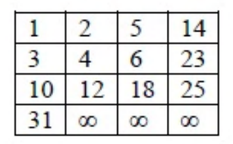

# 2015 CS2 Q48: Entries shifted when removing 1 from a Young tableau

## Question

A Young tableau is a 2D array of integers increasing from left to right and from top to bottom. Any unfilled entries are marked with $\infty$, and hence there cannot be any entry to the right of, or below a $\infty$. The following Young tableau consists of unique entries.

When an element is removed from a Young tableau, other elements should be moved into its place so that the resulting table is still a Young tableau (unfilled entries may be filled in with a $\infty$). The minimum number of entries (other than 1) to be shifted, to remove 1 from the given Young tableau is ________

Answer

**5**

Solution

Removing the corner entry leaves a hole at row 0, column 0. Fill each hole with the **smaller** of its right and lower neighbours. (The larger one would end up left of, or above, a smaller entry.)

| Hole | Right | Below | Moves in |
|---|---|---|---|
| (0,0) | 2 | 3 | **2** |
| (0,1) | 5 | 4 | **4** |
| (1,1) | 6 | 12 | **6** |
| (1,2) | 23 | 18 | **18** |
| (2,2) | 25 | $\infty$ | **25** |
| (2,3) | none | $\infty$ | becomes $\infty$ |

Result:

| | | | |
|---|---|---|---|
| 2 | 4 | 5 | 14 |
| 3 | 6 | 18 | 23 |
| 10 | 12 | 25 | $\infty$ |
| 31 | $\infty$ | $\infty$ | $\infty$ |

Shifted entries: $2, 4, 6, 18, 25$, which is **5**.

**Code check:** a short simulation of this rule shifts the same five entries and gives the same final tableau.

**Key idea:** deleting the minimum from a Young tableau slides entries along a monotone path, exactly like a heap's sift-down. At each step the smaller neighbour moves in.

