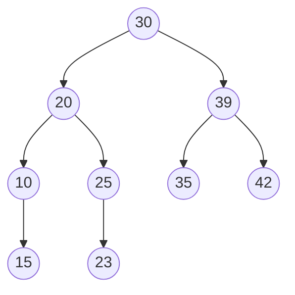

# 2013 CS Q43: Postorder from a BST preorder

## Question

The preorder traversal sequence of a binary search tree is 30, 20, 10, 15, 25, 23, 39, 35, 42. Which one of the following is the postorder traversal sequence of the same tree?

- (A) 10, 20, 15, 23, 25, 35, 42, 39, 30
- (B) 15, 10, 25, 23, 20, 42, 35, 39, 30
- (C) 15, 20, 10, 23, 25, 42, 35, 39, 30
- (D) 15, 10, 23, 25, 20, 35, 42, 39, 30

Answer

**D**

Solution

**Build the tree.** The first preorder key, 30, is the root. Keys less than 30 (20, 10, 15, 25, 23) form the left subtree and keys greater than 30 (39, 35, 42) the right subtree. Repeat in each part.

(15 is the right child of 10, 23 is the left child of 25.)

**Postorder** (left, right, root): left subtree of 20 is $10$ with child $15$, giving $15, 10$; then $23, 25$; then $20$; then $35, 42, 39$; then $30$.

$$15,\ 10,\ 23,\ 25,\ 20,\ 35,\ 42,\ 39,\ 30$$

**Why the others fail:**

- (A) starts with 10, but 15 is below 10 so it must come first.
- (B) puts 25 before 23, but 23 is a descendant of 25.
- (C) puts 20 before 10, but 10 is in 20's subtree.

**Code check:** a script that rebuilt the BST from the preorder printed this postorder.

**Key idea:** a BST is determined by its preorder; split at the first key larger than the root.

