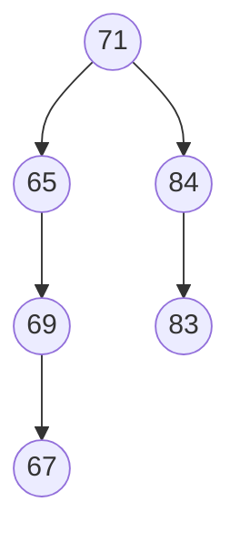

# 2015 CS3 Q27: Element at the lowest level of a binary search tree

## Question

While inserting the elements 71, 65, 84, 69, 67, 83 in an empty binary search tree (BST) in the sequence shown, the element in the lowest level is

- (A) 65
- (B) 67
- (C) 69
- (D) 83

Answer

**B**

Solution

Insert one by one, going left for smaller and right for larger:

| Insert | Path | Placed as |
|---|---|---|
| 71 | | root |
| 65 | $< 71$ | left of 71 |
| 84 | $> 71$ | right of 71 |
| 69 | $<71$, $>65$ | right of 65 |
| 67 | $<71$, $>65$, $<69$ | left of 69 |
| 83 | $>71$, $<84$ | left of 84 |

67 is at level 3, the deepest. 69 and 83 are at level 2, and 65 at level 1. Option (B).

**Key idea:** a BST insert follows one root-to-leaf path. The last chain, 71 → 65 → 69 → 67, is the longest.

