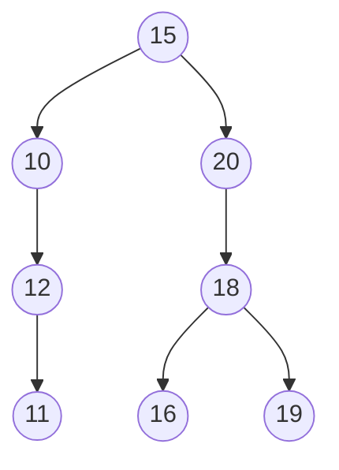

# 2020 CS Q15: Postorder of a BST from its preorder

## Question

The preorder traversal of a binary search tree is 15, 10, 12, 11, 20, 18, 16, 19.

Which one of the following is the postorder traversal of the tree?

- (A) 10, 11, 12, 15, 16, 18, 19, 20
- (B) 11, 12, 10, 16, 19, 18, 20, 15
- (C) 20, 19, 18, 16, 15, 12, 11, 10
- (D) 19, 16, 18, 20, 11, 12, 10, 15

Answer

**B**

Solution

**Rebuild the tree.** Preorder visits the root first, so insert the keys in the given order into an empty BST:

| Key | Path | Placed as |
|---|---|---|
| 15 | | root |
| 10 | $<15$ | left child of 15 |
| 12 | $<15$, $>10$ | right child of 10 |
| 11 | $<15$, $>10$, $<12$ | left child of 12 |
| 20 | $>15$ | right child of 15 |
| 18 | $>15$, $<20$ | left child of 20 |
| 16 | $>15$, $<20$, $<18$ | left child of 18 |
| 19 | $>15$, $<20$, $>18$ | right child of 18 |

Here 10 has only a right child (12), 12 has only a left child (11), and 20 has only a left child (18).

**Postorder** (left, right, root):

- Left subtree of 15: 11, 12, 10
- Right subtree of 15: 16, 19, 18, 20
- Root: 15

Postorder: **11, 12, 10, 16, 19, 18, 20, 15**. I confirmed this by building the tree in code and printing its postorder.

**Why the others fail:**

- **(A)** is the *inorder* traversal: a BST's inorder is always sorted.
- **(C)** is the sorted order reversed, not a postorder.
- **(D)** puts 19 before 16, but 16 is the left child of 18, so it must come before 19.

**Key idea:** a BST is fully determined by its preorder, because inserting the keys in preorder order rebuilds it.

