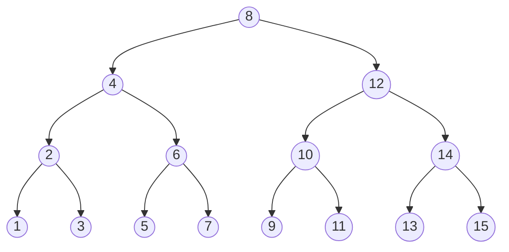

# 2026 CS1 Q40: BST insertion order giving a complete tree

## Question

Let $P$ be the set of all integers from 1 to 15. Consider any order of insertion of the elements of $P$ into a binary search tree that creates a complete binary tree.

Which one of the following elements can **NEVER** be the third element that is inserted?

- (A) 4
- (B) 2
- (C) 10
- (D) 5

Answer

**D (5)**

Solution

15 nodes in a complete binary tree means a **perfect** tree of 4 levels. The BST on $1..15$ with that shape is unique:

BST insertion puts a key under its parent only if the parent is already in the tree. So an insertion order produces this tree **iff every node is inserted after its parent**.

- 1st insert: must be the root, **8**.
- 2nd insert: a child of 8, so **4** or **12**.
- 3rd insert: the other child of 8, or a child of the 2nd element, so one of **4, 12, 2, 6, 10, 14**.

The leaves $1,3,5,7,9,11,13,15$ need their parent (level 3) first, so they cannot be third.

- 4: order 8, 12, 4. Possible.
- 2: order 8, 4, 2. Possible.
- 10: order 8, 12, 10. Possible.
- **5**: its parent 6 needs 4 before it, so 5 comes 4th at the earliest. **Never** third.

A brute-force search over valid prefixes confirms the possible third elements are $\lbrace 2,4,6,10,12,14 \rbrace$.

**Key idea:** a BST has a fixed shape for a given insertion order only if parents come before children, so use a top-down (parent before child) ordering argument.

