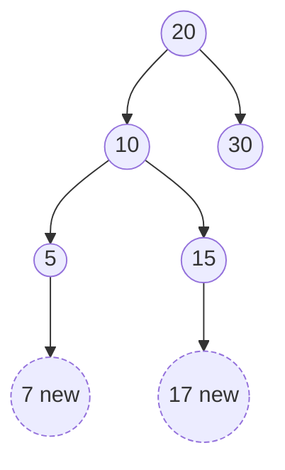

# 2026 CS2 Q49: New keys between leaves and inorder successors

## Question

Consider a binary search tree (BST) with $n$ leaf nodes ($n > 0$). Given any node $V$, the key present in the node is denoted $Val(V)$. All keys in the BST are distinct real numbers.

For a node $V$, let $Suc(V)$ denote its inorder successor (NULL if none). If $Suc(V)$ is not NULL, then $Val(V) < Val(Suc(V))$.

Corresponding to every leaf node $L_i$ that has a non-NULL $Suc(L_i)$, a new key $k_i$ with $Val(L_i) < k_i < Val(Suc(L_i))$ is to be inserted into the BST. Let $K$ be the list of all such new keys.

Which of the following statements is/are true?

- (A) $K$ cannot have any duplicates
- (B) $K$ will have at least one element
- (C) After inserting all keys from $K$, the height of the BST can increase at most by one
- (D) Number of nodes in the BST will double after inserting all keys from $K$

Answer

**A and C**

Solution

**Example.** BST with root 20, children 10 and 30, and 10 has children 5 and 15. Inorder: $5,10,15,20,30$.

- Leaves: 5, 15, 30.
- Successors: $Suc(5)=10$, $Suc(15)=20$, $Suc(30)=$ NULL (30 is the maximum, so no key for it).
- New keys: $k_1 \in (5,10)$, e.g. 7; $k_2 \in (15,20)$, e.g. 17.

**(A) True.** Each $k_i$ lies strictly between two *consecutive* inorder keys. Different leaves give different consecutive pairs, whose open intervals do not overlap. So the $k_i$ are in disjoint ranges and cannot be equal.

**(B) False.** If the only leaf is the maximum key (for example a one-node tree, or a chain going right), it has no successor, so $K$ is empty.

**(C) True.** A leaf $L$ has no right child. The new key is greater than $Val(L)$ and smaller than its successor, so the search for it ends at $L$ and it becomes the **right child of $L$**. Each new key is attached below a different leaf, so each leaf gets at most one new child and the height grows by at most 1.

**(D) False.** $|K| \le$ (number of leaves) $- 1 <$ (total nodes), so the node count cannot double.

A simulation on 3000 random BSTs found a maximum height increase of 1, empty $K$ in some trees, no duplicate keys, and no case where the node count doubled.

**Key idea:** a leaf's inorder successor is an ancestor, and a key between the two always lands as the leaf's right child.

