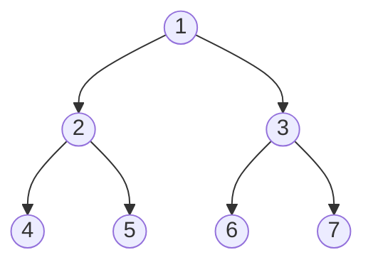

# 2026 CS1 Q23: Non-leaf indices of a min-heap

## Question

Let $n$ be an odd number greater than 100. Consider a binary min-heap with $n$ elements stored in an array $P$ whose index starts from 1.

Which of the following indices of $P$ do/does **NOT** correspond to any leaf node of the min-heap?

- (A) $\frac{n+1}{2}$
- (B) $\frac{n-1}{2}$
- (C) $\frac{n-3}{2}$
- (D) $n$

Answer

**B and C**

Solution

In a 1-indexed heap, node $i$ has children $2i$ and $2i+1$. Node $i$ is a leaf exactly when it has no children, i.e. when $2i > n$, so $i > \lfloor n/2 \rfloor$.

Since $n$ is odd, $\lfloor n/2 \rfloor = \frac{n-1}{2}$. So:

- internal nodes: $1, 2, \dots, \frac{n-1}{2}$
- leaves: $\frac{n+1}{2}, \dots, n$

*Example $n=7$: internal nodes are 1 to 3 (which is $\frac{n-1}{2}$), leaves are 4 to 7.*

| Option | Index | Leaf? |
|---|---|---|
| A | $\frac{n+1}{2}$ | Yes, the first leaf |
| B | $\frac{n-1}{2}$ | **No**, the last internal node (children $n-1$ and $n$) |
| C | $\frac{n-3}{2}$ | **No**, internal |
| D | $n$ | Yes, the last leaf |

Checked for $n = 101, 103, 121, 255$: indices B and C are always internal.

**Key idea:** with 1-based indexing, leaves of an $n$-element heap are indices $\lfloor n/2 \rfloor + 1$ to $n$.

