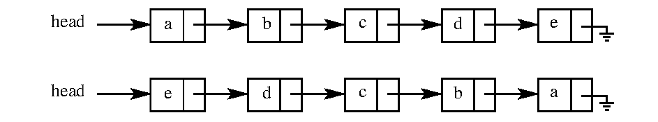

# 2022 CS Q15: Reversing a singly linked list in O(1) space

## Question

Consider the problem of reversing a singly linked list. To take an example, given the linked list below,



the reversed linked list should look like the second list in the figure.

Which one of the following statements is TRUE about the time complexity of algorithms that solve the above problem in $O(1)$ space?

- (A) The best algorithm for the problem takes $\Theta(n)$ time in the worst case.
- (B) The best algorithm for the problem takes $\Theta(n \log n)$ time in the worst case.
- (C) The best algorithm for the problem takes $\Theta(n^2)$ time in the worst case.
- (D) It is not possible to reverse a singly linked list in $O(1)$ space.

<details class="success" markdown="1">
<summary>Answer</summary>

**A (Θ(n) in the worst case)**

</details>

<details class="info" markdown="1">
<summary>Solution</summary>

**Reverse the links in one pass** using three pointers:

```c
prev = NULL; cur = head;
while (cur) {
    next = cur->next;
    cur->next = prev;
    prev = cur;
    cur = next;
}
head = prev;
```

This visits each node once and uses a constant number of pointers, so it takes $O(n)$ time and $O(1)$ extra space.

**It cannot be faster.** Every node's `next` pointer must change, so any algorithm needs $\Omega(n)$ time. Hence the best worst case is $\Theta(n)$.

**Why the others fail:**
- (B) and (C) describe slower algorithms, not the best one.
- (D) is false, as the loop above shows.

**Code check:** the loop above compiled with `gcc -Wall` with no warnings and turned a list `a b c d e` into `e d c b a`.

**Key idea:** in-place list reversal by pointer flipping is linear time and constant space.

</details>
