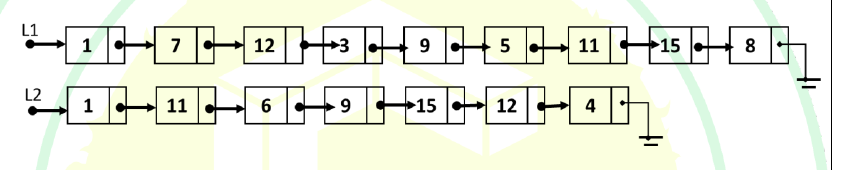
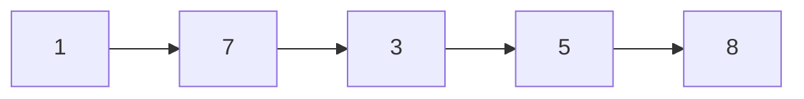

# 2025 CS1 Q62: Removing nodes of L1 that appear in L2

## Question

Let `LIST` be a datatype for an implementation of linked list defined as follows:

```c
typedef struct list {
    int data;
    struct list *next;
} LIST;
```

Suppose a program has created two linked lists, L1 and L2, whose contents are given in the figure below (code for creating L1 and L2 is not provided here). L1 contains 9 nodes, and L2 contains 7 nodes.



Consider the following C program segment that modifies the list L1. The number of nodes that will be there in L1 after the execution of the code segment is ________ . (Answer in integer)

```c
int find (int query, LIST *list) {
    while (list != NULL){
        if(list->data == query) return 1;
        list = list->next;
    }
    return 0;
}
int main () {
    ... ... ...
    ptr1=L1; ptr2=L2;
    while (ptr1->next != NULL){
        query = ptr1->next->data;
        if (find (query, L2))
            ptr1->next = ptr1->next->next;
        else ptr1 = ptr1->next;
    }
    ... ... ...
    return 0;
}
```

<details class="success" markdown="1">
<summary>Answer</summary>

**5**

</details>

<details class="info" markdown="1">
<summary>Solution</summary>

$L1 = 1, 7, 12, 3, 9, 5, 11, 15, 8$ and $L2 = 1, 11, 6, 9, 15, 12, 4$.

The loop always looks at the node **after** `ptr1`. If that value is in L2, the node is unlinked (`ptr1` stays put). Otherwise `ptr1` moves forward.

| `ptr1` at | Next value | In L2? | Action |
|---|---|---|---|
| 1 | 7 | no | advance |
| 7 | 12 | yes | unlink 12 |
| 7 | 3 | no | advance |
| 3 | 9 | yes | unlink 9 |
| 3 | 5 | no | advance |
| 5 | 11 | yes | unlink 11 |
| 5 | 15 | yes | unlink 15 |
| 5 | 8 | no | advance |
| 8 | NULL | | loop ends |


*L1 after the loop: 1, 7, 3, 5, 8.*

So 4 nodes were removed (12, 9, 11, 15) and **5 remain**.

**Subtle point.** The head value 1 also appears in L2, but it is never tested: the loop only examines `ptr1->next`, and `ptr1` starts at the head. So the head always stays. The unlinked nodes are not freed (a memory leak), but that does not affect the count.

I built both lists in C, ran this exact loop (`gcc -Wall -Wextra -std=c11`, no warnings), and it printed `1 7 3 5 8` with count 5.

**Key idea:** testing `ptr1->next` lets a singly linked list delete a node without a back pointer, but the head itself can never be deleted this way.

</details>
