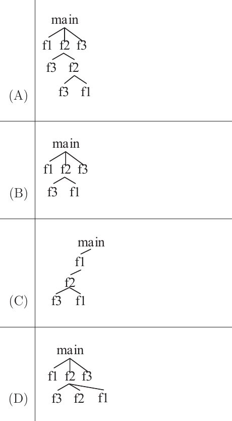
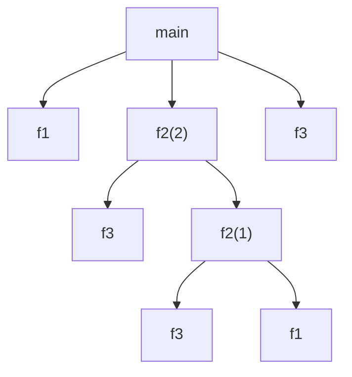

# 2023 CS Q36: Activation tree of a program

## Question

Consider the following program:

```c
int main() {
  f1();
  f2(2);
  f3();
  return(0);
}
int f1() { return(1); }
int f2(int X) {
  f3();
  if (X==1)
    return f1();
  else
    return (X*f2(X-1));
}
int f3() { return(5); }
```

Which one of the following options represents the activation tree corresponding to the main function?



<details class="success" markdown="1">
<summary>Answer</summary>

**A**

</details>

<details class="info" markdown="1">
<summary>Solution</summary>

**Trace the calls in order.**

1. `main` calls `f1()`, then `f2(2)`, then `f3()`.
2. `f2(2)` first calls `f3()`. Since $X=2 \ne 1$ it then calls `f2(1)`.
3. `f2(1)` first calls `f3()`. Since $X=1$ it then calls `f1()`.

**Activation tree:**



This is option **A**: `main` has children f1, f2, f3, and f2 has children f3 and f2, whose children are f3 and f1.

**Why the others fail:**
- **B** stops after `f2(2)`: it misses the recursive call `f2(1)`.
- **C** shows `f2` called from `f1`, but `main` calls `f2` directly.
- **D** puts `f2` and `f1` as direct children of the first `f2`, which skips the nested call structure.

**Key idea:** in an activation tree, each call is a child of its caller. Siblings are in call order.

</details>
