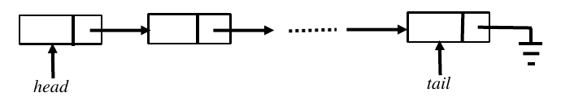

# 2018 CS Q13: Queue on a singly linked list: enqueue at head, dequeue at tail

## Question

A queue is implemented using a non-circular singly linked list. The queue has a head pointer and a tail pointer, as shown in the figure. Let $n$ denote the number of nodes in the queue. Let `enqueue` be implemented by inserting a new node at the head, and `dequeue` be implemented by deletion of a node from the tail.

Which one of the following is the time complexity of the most time-efficient implementation of `enqueue` and `dequeue`, respectively, for this data structure?

- (A) $\theta(1),\ \theta(1)$
- (B) $\theta(1),\ \theta(n)$
- (C) $\theta(n),\ \theta(1)$
- (D) $\theta(n),\ \theta(n)$

Answer

**B**

Solution

**enqueue (insert at head):** create a node, point its `next` to the old head, and move `head` to it. That is a fixed number of steps: $\theta(1)$.

**dequeue (delete at tail):** the new tail must be the node *before* the old tail, and its `next` must become null. A singly linked node has no pointer back, and the `tail` pointer does not help, since we need the predecessor. We must walk from `head` through $n-1$ nodes: $\theta(n)$.

**Why the others fail:**
- **A** would need a doubly linked list (tail's `prev` pointer).
- **C** swaps the two costs.
- **D** overstates enqueue; the head pointer gives direct access.

**Key idea:** in a singly linked list, deleting the *last* node needs its predecessor, which costs a full traversal. A queue should enqueue at the tail and dequeue at the head instead.

