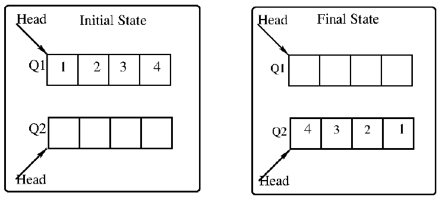

# 2022 CS Q62: Reversing four elements between two queues

## Question

Consider the queues Q1 containing four elements and Q2 containing none (shown as the Initial State in the figure). The only operations allowed on these two queues are Enqueue(Q, element) and Dequeue(Q). The minimum number of Enqueue operations on Q1 required to place the elements of Q1 in Q2 in reverse order (shown as the Final State in the figure) without using any additional storage is ______.

Answer

**0**

Solution

**Only Enqueues on Q1 are counted.** Q2 may be used freely, including taking an element out of Q2 and putting it back at the end of Q2 (a rotation). That is not extra storage, only the two given queues.

**Build the reversal inside Q2.** Insert the next element, then rotate Q2 so the new element reaches the head:

| Move | Q2 (head first) |
| --- | --- |
| Q1 → Q2 (1) | 1 |
| Q1 → Q2 (2) | 1, 2 |
| rotate once | 2, 1 |
| Q1 → Q2 (3) | 2, 1, 3 |
| rotate twice | 3, 2, 1 |
| Q1 → Q2 (4) | 3, 2, 1, 4 |
| rotate three times | 4, 3, 2, 1 |

Q1 is empty and Q2 is $4, 3, 2, 1$. No Enqueue was done on Q1, so the answer is **0**.

**Code check:** a shortest-path search over all states (cost = Enqueues on Q1) also gives 0.

**Key idea:** rotating a queue by dequeue-and-enqueue on itself brings any element to the head, so reversal needs no help from the source queue.

