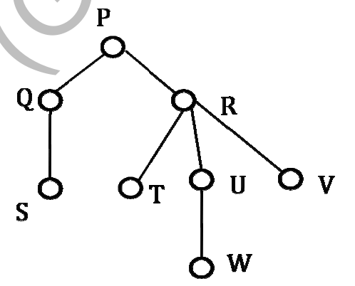

# 2014 CS3 Q12: In-order traversal of a rooted tree

## Question

Consider the following rooted tree with the vertex labeled P as the root:

The order in which the nodes are visited during an in-order traversal of the tree is

- (A) SQPTRWUV
- (B) SQPTUWRV
- (C) SQPTWUVR
- (D) SQPTRUWV

Answer

**A**

Solution

For a tree with more than two children, in-order means: visit the **first child's subtree**, then the **node**, then the **remaining children's subtrees** (each in in-order), left to right.

Apply it recursively:

- $Q$: first child $S$, so $S, Q$.
- $U$: first child $W$, so $W, U$.
- $R$: first child $T$, then $R$, then the rest $U$-subtree and $V$: $T, R, W, U, V$.
- $P$: first child's subtree ($S, Q$), then $P$, then $R$'s subtree.

$$S\,Q\,P\,T\,R\,W\,U\,V$$

- (B) puts $U$ before its child $W$ and $R$ after its subtree.
- (C) puts $R$ last, after all its children (a post-order-like pattern).
- (D) visits $U$ before $W$, so the subtree of $U$ is not in in-order.

**Code check:** a small recursive program with this rule prints `SQPTRWUV`. Pre-order gives `PQSRTUWV` and post-order `SQTWUVRP`, so the other orders do not match any option.

**Note:** in-order is defined for binary trees. The convention above is the one the key uses.

**Key idea:** in-order = left part, root, then the rest of the children.

