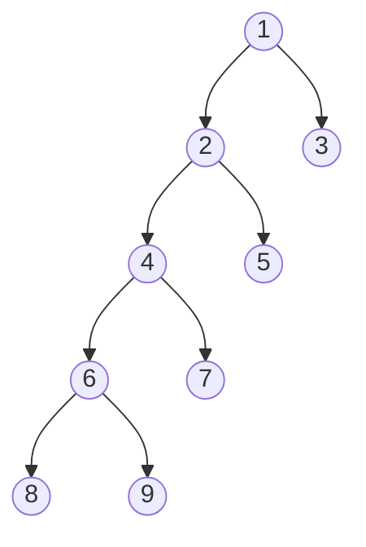

# 2018 CS Q30: Height of a binary tree from postorder and inorder

## Question

The postorder traversal of a binary tree is 8,9,6,7,4,5,2,3,1. The inorder traversal of the same tree is 8,6,9,4,7,2,5,1,3. The height of a tree is the length of the longest path from the root to any leaf. The height of the binary tree above is ______.

Answer

**4**

Solution

**Rebuild the tree.** The last postorder element is the root; it splits the inorder list into left and right parts.

| Subtree | Postorder | Inorder | Root | Left / right inorder |
|---|---|---|---|---|
| whole | 8,9,6,7,4,5,2,3,1 | 8,6,9,4,7,2,5,1,3 | 1 | 8,6,9,4,7,2,5 / 3 |
| left of 1 | 8,9,6,7,4,5,2 | 8,6,9,4,7,2,5 | 2 | 8,6,9,4,7 / 5 |
| left of 2 | 8,9,6,7,4 | 8,6,9,4,7 | 4 | 8,6,9 / 7 |
| left of 4 | 8,9,6 | 8,6,9 | 6 | 8 / 9 |

**The tree:**

The longest path is $1\to2\to4\to6\to8$, which has **4 edges**, so the height is **4**.

**Code check:** a recursive rebuild gave preorder 1,2,4,6,8,9,7,5,3 and height 4.

**Key idea:** postorder gives the root (last element), inorder tells you which nodes go left and right.

