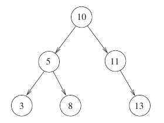

# 2023 CS Q47: Post-order subtree sums printed by foo

## Question

Consider the C function `foo` and the binary tree shown.

```c
typedef struct node {
  int val;
  struct node *left, *right;
} node;

int foo(node *p) {
  int retval;
  if (p == NULL)
    return 0;
  else {
    retval = p->val + foo(p->left)
                    + foo(p->right);
    printf("%d ", retval);
    return retval;
  }
}
```



When `foo` is called with a pointer to the root node of the given binary tree, what will it print?

- (A) 3 8 5 13 11 10
- (B) 3 5 8 10 11 13
- (C) 3 8 16 13 24 50
- (D) 3 16 8 50 24 13

<details class="success" markdown="1">
<summary>Answer</summary>

**C (3 8 16 13 24 50)**

</details>

<details class="info" markdown="1">
<summary>Solution</summary>

**What `foo` does.** It computes the sum of the subtree rooted at `p` and prints it **after** both children are done. So it prints subtree sums in **post-order**.

| Node | Subtree sum | Printed |
|---|---|---|
| 3 | 3 | 3 |
| 8 | 8 | 8 |
| 5 | 5 + 3 + 8 | 16 |
| 13 | 13 | 13 |
| 11 | 11 + 0 + 13 | 24 |
| 10 | 10 + 16 + 24 | 50 |

Output: `3 8 16 13 24 50`.

**Code check:** the tree built in C and run with `gcc -Wall` prints exactly this.

**Why the others fail:** A prints plain node values. B is an in-order or sorted list of values. D has the right sums in the wrong order (a pre-order pattern).

**Key idea:** printing after the recursive calls gives post-order. The printed value is the whole subtree's sum.

</details>
