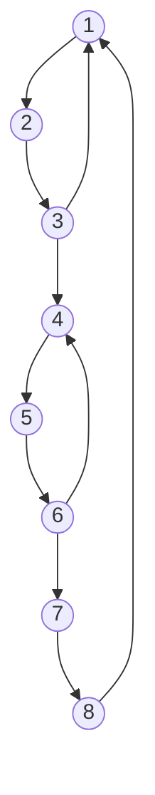

# 2015 CS3 Q58: McCabe cyclomatic complexity of three programs

## Question

Consider three software items: Program-X, Control Flow Diagram of Program-Y and Control Flow Diagram of Program-Z as shown below.

The values of McCabe's cyclomatic complexity of Program-X, Program-Y, and Program-Z respectively are

- (A) 4, 4, 7
- (B) 3, 4, 7
- (C) 4, 4, 8
- (D) 4, 3, 8

Answer

**A**

Solution

**Program-X.** Count the decisions, treating each `if` or `while` as **one** decision (even though the `while` has an `AND`):

- `if (value < 0)`
- `while (...)`
- `if (result <= maxint)`

$P = 3$, so $M = P + 1 = \mathbf{4}$.

**Program-Y.** Read the graph: 8 nodes in a chain, so 7 edges, plus 3 back edges (node 3 to 1, node 6 to 4, node 8 to 1):

$$E = 10,\quad N = 8,\quad M = E - N + 2 = 10 - 8 + 2 = \mathbf{4}$$

**Program-Z.** X followed by Y in sequence. Joining two graphs with one edge gives

$$M_Z = M_X + M_Y - 1 = 4 + 4 - 1 = \mathbf{7}$$

So 4, 4, 7: option (A).

- (B) has 3 for X: it forgets the $+1$.
- (C) has 8 for Z: it adds $4 + 4$ without subtracting 1.
- (D) has both errors.

**Convention.** If the `AND` in the `while` were counted as two separate decisions (short-circuit evaluation), X would be 5 and Z 8, and no option would match. The key counts a compound condition as one decision.

**Code check:** edge-and-node counts for X (11 edges, 9 nodes), Y (10, 8) and Z (X, one joining edge, then Y) give 4, 4 and 7. Splitting the `AND` gives X $= 5$.

**Key idea:** $M = E - N + 2 = $ decisions $+ 1$. For two programs in sequence, $M = M_1 + M_2 - 1$.

