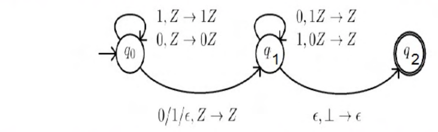

# 2015 CS1 Q50: String that completes an input accepted by a given NPDA

## Question

Consider the NPDA $(Q = \lbrace q_0, q_1, q_2 \rbrace,\ \Sigma = \lbrace 0,1 \rbrace,\ \Gamma = \lbrace 0, 1, \perp \rbrace,\ \delta,\ q_0,\ \perp,\ F = \lbrace q_2 \rbrace)$, where (as per usual convention) $Q$ is the set of states, $\Sigma$ is the input alphabet, $\Gamma$ is the stack alphabet, $\delta$ is the state transition function, $q_0$ is the initial state, $\perp$ is the initial stack symbol, and $F$ is the set of accepting states. The state transition is as follows:

Which one of the following sequences must follow the string 101100 so that the overall string is accepted by the automaton?

- (A) 10110
- (B) 10010
- (C) 01010
- (D) 01001

Answer

**B**

Solution

**Reading the machine** ($Z$ stands for "whatever is on top"):

- In $q_0$ every input symbol is **pushed**.
- $q_0 \to q_1$ is an optional move that consumes **one free symbol** (0, 1) or none ($\epsilon$), leaving the stack alone.
- In $q_1$, input $0$ pops a $1$ and input $1$ pops a $0$. So the input must match the stack top-down with every bit **complemented**.
- $q_1 \to q_2$ pops $\perp$ on $\epsilon$, which needs the stack to be empty.

So accepted strings have the form $u \cdot m \cdot \overline{u}^{R}$ with $m \in \lbrace 0, 1, \epsilon \rbrace$, where $\overline{u}^R$ is the reversed complement of $u$.

**Test the options.** Every option has 5 symbols, so the full string has $6 + 5 = 11$ symbols. The accepted form has length $2|u|$ or $2|u|+1$, so $|u| = 5$ and there is a middle symbol $m$.

- The first 5 symbols of $101100\,s$ are always $u = 10110$, and the 6th is always $m = 0$.
- The last 5 symbols (which are $s$) must equal $\overline{u}^R$: reverse of $u$ is $01101$, and its complement is $10010$.

So $s = 10010$ is forced, and only (B) matches. (A), (C) and (D) have the right length but the wrong last-five pattern.

Option (B).

**Code check:** a small nondeterministic simulator of this machine accepted only $101100\,10010$ among the four options.

**Key idea:** the PDA accepts $u\,m\,\overline{u}^{R}$: push a prefix, skip one middle symbol, then match the reversed complement.

