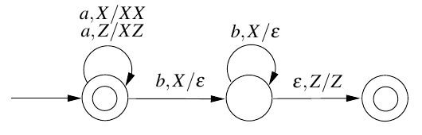

# 2016 CS1 Q43: Language accepted by a given PDA

## Question

Consider the transition diagram of a PDA given below with input alphabet $\Sigma = \lbrace a, b \rbrace$ and stack alphabet $\Gamma = \lbrace X, Z \rbrace$. $Z$ is the initial stack symbol. Let $L$ denote the language accepted by the PDA.

- (A) $L = \lbrace a^n b^n \mid n \ge 0 \rbrace$ and is not accepted by any finite automata
- (B) $L = \lbrace a^n \mid n \ge 0 \rbrace \cup \lbrace a^n b^n \mid n \ge 0 \rbrace$ and is not accepted by any deterministic PDA
- (C) $L$ is not accepted by any Turing machine that halts on every input
- (D) $L = \lbrace a^n \mid n \ge 0 \rbrace \cup \lbrace a^n b^n \mid n \ge 0 \rbrace$ and is deterministic context-free

Answer

**D**

Solution

**Read the machine.**

- $q_0$ (accepting, start): on $a$ it pushes an $X$ (for the first $a$, $Z$ stays below). On $b$ with $X$ on top it pops and moves to $q_1$.
- $q_1$: on $b$ with $X$ on top it pops. When $Z$ is on top it moves, without reading input, to $q_2$ (accepting).

**What is accepted.**

- Only $a$'s read (including none): the run stays in $q_0$, which is accepting, so $a^n$ for $n \ge 0$ is accepted.
- $a^n$ then $b$'s: each $b$ pops one $X$, and only when all $X$'s are gone can the machine reach $q_2$. So exactly $a^n b^n$ ($n \ge 1$).

$$L = \lbrace a^n \mid n \ge 0 \rbrace \cup \lbrace a^n b^n \mid n \ge 0 \rbrace$$

**It is deterministic.** In every state, for each input symbol and each stack top there is at most one move, and the $\varepsilon$-move in $q_1$ only applies when $Z$ is on top, where there is no $b$-move. So $L$ is deterministic context-free: **(D)**.

**Why the others fail.**

- (A) claims $L = \lbrace a^n b^n \rbrace$ only, but $a^n$ alone is also accepted.
- (B) is the right language but wrongly says no deterministic PDA accepts it; this machine is one.
- (C) is false: every context-free language is decidable, so a halting Turing machine accepts it.

**Code check:** simulating this PDA on every string over $\lbrace a, b \rbrace$ of length up to $8$ accepted exactly $a^n$ and $a^n b^n$.

**Key idea:** the PDA accepts $a^n$ and $a^n b^n$, and has no conflicting transitions, so it is deterministic.

