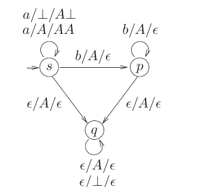

# 2023 CS Q40: Language accepted by a PDA (empty stack)

## Question

Consider the pushdown automaton (PDA) $P$ below, which runs on the input alphabet $\lbrace a, b \rbrace$, has stack alphabet $\lbrace \bot, A \rbrace$, and has three states $\lbrace s, p, q \rbrace$, with $s$ being the start state. A transition from state $u$ to state $v$, labelled $c/X/\gamma$, where $c$ is an input symbol or $\epsilon$, $X$ is a stack symbol, and $\gamma$ is a string of stack symbols, represents the fact that in state $u$, the PDA can read $c$ from the input, with $X$ on the top of its stack, pop $X$ from the stack, push in the string $\gamma$ on the stack, and go to state $v$. In the initial configuration, the stack has only the symbol $\bot$ in it. The PDA accepts by empty stack.

Which one of the following options correctly describes the language accepted by $P$?

- (A) $\lbrace a^m b^n \mid 1 \le m \text{ and } n < m \rbrace$
- (B) $\lbrace a^m b^n \mid 0 \le n \le m \rbrace$
- (C) $\lbrace a^m b^n \mid 0 \le m \text{ and } 0 \le n \rbrace$
- (D) $\lbrace a^m \mid 0 \le m \rbrace \cup \lbrace b^n \mid 0 \le n \rbrace$

Answer

**A ($\lbrace a^m b^n \mid 1 \le m,\ n < m \rbrace$)**

Solution

**Stage 1 (state $s$): read the $a$'s.** With only $\bot$ on the stack, the sole move is $a/\bot/A\bot$. So the first symbol must be $a$ (hence $m \ge 1$). Each later $a$ pushes another $A$. After $a^m$ the stack is $A^m\bot$.

**Stage 2 (states $s$, $p$): read the $b$'s.** Each $b$ pops one $A$. After $b^n$ the stack is $A^{m-n}\bot$ (needs $n \le m$).

**Stage 3 (state $q$): empty the stack.** The only way into $q$ is a move $\epsilon/A/\epsilon$, which **pops an $A$**. So at least one $A$ must still be on the stack: $m - n \ge 1$. In $q$ the PDA pops the rest of the $A$'s and finally $\bot$, so the stack becomes empty.

If $n = m$, the stack is only $\bot$ and no move pops $\bot$ from $s$ or $p$, so the PDA is stuck and does not accept.

So the language is $\lbrace a^m b^n \mid m \ge 1,\ n < m \rbrace$.

**Code check:** a simulator of the PDA agreed with this description on every string up to length 10.

**Why the others fail:** B allows $n = m$ and $m = 0$ (the empty string needs an $a$ first). C and D accept far more than the stack can match.

**Key idea:** a PDA that accepts by empty stack must be able to pop *everything*. Here the entry to the cleaning state needs one leftover $A$.

