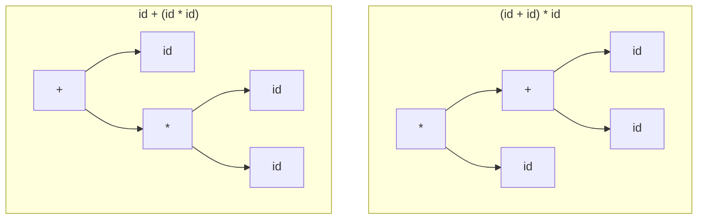

# 2026 CS2 Q29: Which grammars are ambiguous

## Question

Which of the following grammars is/are ambiguous?

- (A) $S \to aSb \mid \epsilon$
- (B) $E \to E + E \mid E * E \mid id$
- (C) $S \to aS \mid Sa \mid \epsilon$
- (D) $S \to aS \mid \epsilon$

Answer

**B and C**

Solution

A grammar is ambiguous if some string has **two parse trees**.

**(A) $S \to aSb \mid \epsilon$: not ambiguous.** It generates $a^n b^n$ and each string has exactly one way to peel off the outer $a \dots b$.

**(B) $E \to E + E \mid E * E \mid id$: ambiguous.** The string $id + id * id$ has two trees:

**(C) $S \to aS \mid Sa \mid \epsilon$: ambiguous.** The string $a$ has two trees: $S \to aS \to a\epsilon$ and $S \to Sa \to \epsilon a$.

**(D) $S \to aS \mid \epsilon$: not ambiguous.** It generates $a^*$, and each $a^n$ has only one derivation (peel one $a$ at a time).

**Verified.** I counted the parse trees by program: $id+id*id$ has 2.

**Key idea:** ambiguity comes from two recursive choices that can build the same string, such as $E + E$ vs $E * E$ with no precedence, or $aS$ vs $Sa$.

