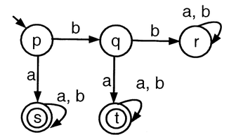

# 2011 CS Q45: Minimal DFA equivalent to a given DFA

## Question

A deterministic finite automaton (DFA) $D$ with alphabet $\Sigma = \lbrace a, b \rbrace$ is given below.

Which of the following finite state machines is a valid minimal DFA which accepts the same language as $D$?

Answer

**A**

Solution

**Language of $D$.** From $p$: reading $a$ reaches the accepting sink $s$, so every string starting with $a$ is accepted. Reading $b$ reaches $q$; from $q$, $a$ reaches the accepting sink $t$ and $b$ reaches the rejecting sink $r$. So $L(D) = a(a+b)^* + ba(a+b)^*$.

**Minimizing.** $s$ and $t$ are both accepting states that loop to themselves on every symbol, so they are equivalent and merge into one accepting sink. The remaining states are pairwise distinguishable:

- the accepting sink from the rest: the empty string;
- $r$ from $p$ and $q$: the string $a$ (accepted from $p$ and $q$, rejected from $r$);
- $p$ from $q$: the string $ba$ (accepted from $p$, which goes $b \to q$, $a \to t$; rejected from $q$, which goes $b \to r$).

So the minimal DFA has $4$ states. This is exactly (A): $p \xrightarrow{b} q$, $q \xrightarrow{b} r$, $p \xrightarrow{a} s$, $q \xrightarrow{a} s$.

Why the others fail (a shortest string accepted by one and not the other):

- (B) accepts $b$ (the state after one symbol is accepting), but $D$ does not.
- (C) also accepts $b$.
- (D) has a loop on $b$ at $q$, so $bba$ goes to the accepting state, but $D$ sends $bb$ to the rejecting sink $r$.

**Code check:** comparing $D$ with each option on all strings of length up to $7$ over $\lbrace a, b \rbrace$: (A) agreed everywhere and has $4$ states; (B) first differs on `b`, (C) on `b`, (D) on `bba`.

**Key idea:** minimize by merging equivalent states (here the two accepting sinks); a valid minimal DFA must also accept the same language.

