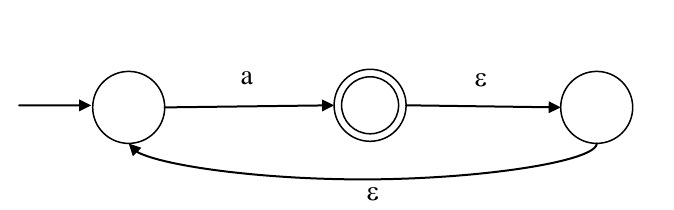

# 2012 CS Q12: Complement of the language of an epsilon NFA

## Question

What is the complement of the language accepted by the NFA shown below? Assume $\Sigma = \lbrace a \rbrace$ and $\varepsilon$ is the empty string.

- (A) $\emptyset$
- (B) $\lbrace \varepsilon \rbrace$
- (C) $a^*$
- (D) $\lbrace a, \varepsilon \rbrace$

Answer

**B**

Solution

Name the states $q_0$ (start), $q_1$ (accepting) and $q_2$. Arcs: $q_0 \xrightarrow{a} q_1$, $q_1 \xrightarrow{\varepsilon} q_2$, $q_2 \xrightarrow{\varepsilon} q_0$.

- To accept, the NFA must end in $q_1$, and the only way into $q_1$ is an $a$ from $q_0$.
- After each $a$ it can return to $q_0$ through the two $\varepsilon$ arcs, so it can read another $a$.

So the language is $a^+$ (one or more $a$'s). The empty string is not accepted, since the start state is not accepting.

Over $\Sigma = \lbrace a \rbrace$, the complement is $a^* \setminus a^+ = \lbrace \varepsilon \rbrace$: (B).

- (A) is wrong: $\varepsilon \notin a^+$, so $\varepsilon$ is in the complement.
- (C) is the whole universe, not the complement.
- (D) contains $a$, which the NFA accepts.

**Code check:** an $\varepsilon$-closure simulation accepted $a^k$ for $k = 1..6$ and rejected $\varepsilon$.

**Key idea:** a loop of $\varepsilon$ arcs back to the start turns "$a$" into "$a^+$".

