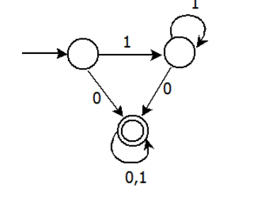

# 2013 CS Q33: Facts about a 3-state DFA

## Question

Consider the DFA $A$ given below.

Which of the following are **FALSE**?

1. Complement of $L(A)$ is context-free.
2. $L(A) = L((11^*0+0)(0+1)^*1^*)$
3. For the language accepted by $A$, $A$ is the minimal DFA.
4. $A$ accepts all strings over $\lbrace 0, 1 \rbrace$ of length at least 2.

- (A) 1 and 3 only
- (B) 2 and 4 only
- (C) 2 and 3 only
- (D) 3 and 4 only

Answer

**D**

Solution

Name the states $q_0$ (start), $q_1$ (loops on 1), $q_2$ (accepting sink).

$q_0 \xrightarrow{0} q_2,\ q_0 \xrightarrow{1} q_1;\quad q_1 \xrightarrow{0} q_2,\ q_1 \xrightarrow{1} q_1;\quad q_2 \xrightarrow{0,1} q_2$.

A string is accepted once it contains a 0 (the first 0 moves to $q_2$): $L(A) = 1^*0(0+1)^*$.

1. **True.** $L(A)$ is regular, so its complement ($1^*$) is regular, hence context-free.
2. **True.** $11^*0 + 0 = 1^*0$, and $(0+1)^*1^* = (0+1)^*$. So the expression equals $1^*0(0+1)^*$.
3. **False.** $q_0$ and $q_1$ have identical transitions (0 to $q_2$, 1 to $q_1$) and are both non-accepting, so they are equivalent. The minimal DFA has **2** states.
4. **False.** The string $11$ has length 2 but stays in $q_1$ and is rejected.

So 3 and 4 are false: (D).

**Why the others fail:** (A) calls 1 false, (B) calls 2 false, (C) calls 2 false; both are true as shown.

**Code check:** a script built the minimal DFA (2 states), confirmed the regular expression matches the DFA on all strings up to a length bound, and showed that 11 is rejected.

**Key idea:** merge states with identical futures to minimise; $(0+1)^*1^* = (0+1)^*$.

