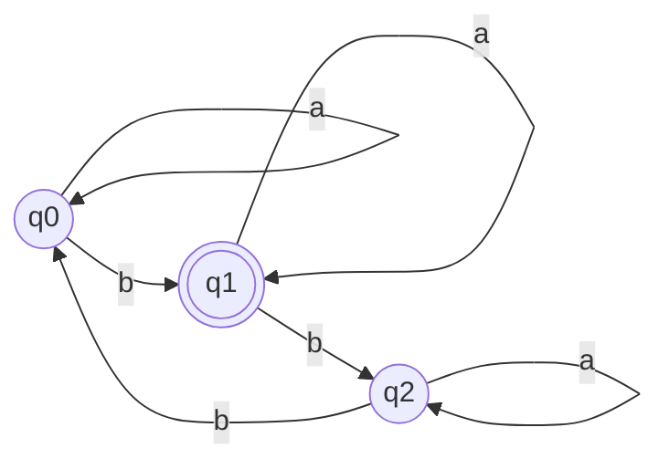

# 2014 CS1 Q15: Which language is regular

## Question

Which one of the following is **TRUE**?

- (A) The language $L = \lbrace a^n b^n \mid n \ge 0 \rbrace$ is regular.
- (B) The language $L = \lbrace a^n \mid n \text{ is prime} \rbrace$ is regular.
- (C) The language $L = \lbrace w \mid w \text{ has } 3k+1 \ b\text{'s for some } k \in \mathbb{N} \text{ with } \Sigma = \lbrace a, b \rbrace \rbrace$ is regular.
- (D) The language $L = \lbrace ww \mid w \in \Sigma^* \text{ with } \Sigma = \lbrace 0,1 \rbrace \rbrace$ is regular.

Answer

**C**

Solution

**(C) is regular.** Track the number of $b$'s modulo 3 with a 3-state DFA. $a$ keeps the state, $b$ moves to the next state, and the state for remainder $1$ is accepting.

**Code check:** the mod-3 counter agreed with `count('b') % 3 == 1` on 2000 random strings.

The others are not regular (pumping lemma):

- (A) $a^n b^n$ needs unbounded counting.
- (B) the gaps between consecutive primes are unbounded, so $a^p$ cannot be pumped.
- (D) $ww$ needs the DFA to remember all of $w$.

**Key idea:** a finite counter (mod $k$) is regular; matching or unbounded counting is not.

