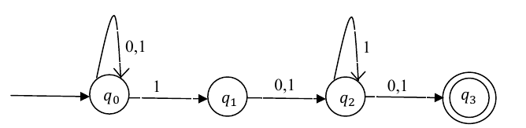

# 2014 CS1 Q16: Reachable states of an NFA on input 0011

## Question

Consider the finite automaton in the following figure.

What is the set of reachable states for the input string 0011?

- (A) $\lbrace q_0, q_1, q_2 \rbrace$
- (B) $\lbrace q_0, q_1 \rbrace$
- (C) $\lbrace q_0, q_1, q_2, q_3 \rbrace$
- (D) $\lbrace q_3 \rbrace$

Answer

**A**

Solution

This is an NFA, so track the **set** of current states.

| Read | States after |
|---|---|
| (start) | $\lbrace q_0 \rbrace$ |
| 0 | $\lbrace q_0 \rbrace$ |
| 0 | $\lbrace q_0 \rbrace$ |
| 1 | $\lbrace q_0, q_1 \rbrace$ |
| 1 | $\lbrace q_0, q_1, q_2 \rbrace$ |

On the last 1: $q_0 \to \lbrace q_0, q_1 \rbrace$, $q_1 \to q_2$.

**Code check:** a set-simulation gives the same final set, $\lbrace q_0, q_1, q_2 \rbrace$.

- (B) forgets that $q_1$ moves to $q_2$ on the last 1.
- (C) $q_3$ needs one more symbol after reaching $q_2$.
- (D) $q_3$ is not reached, and $q_0$ is always present because of its self-loop.

**Key idea:** simulate an NFA with a set of states, one input symbol at a time.

