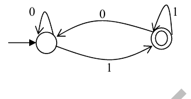

# 2014 CS1 Q36: Regular expressions equivalent to a DFA

## Question

Which of the regular expressions given below represent the following DFA?

- I) `0*1(1+00*1)*`
- II) `0*1*1+11*0*1`
- III) `(0+1)*1`

- (A) I and II only
- (B) I and III only
- (C) II and III only
- (D) I, II, and III

Answer

**B**

Solution

From the figure: reading $1$ always lands in the accepting state, and reading $0$ always lands in the start state. So the DFA accepts exactly the strings **ending in 1**.

- **III** $(0+1)^*1$ is exactly that. **True.**
- **I** $0^*1(1 + 00^*1)^*$: after the first $1$ every block is either $1$ or $0^+1$, so the string ends in $1$. Any string ending in 1 splits this way. **True.**
- **II** $0^*1^*1 + 11^*0^*1$ only gives strings of the form $0^a1^b$ or $1^b0^c1$. The string $0101$ ends in 1 but fits neither. **False.**

**Code check:** compared with the DFA on all strings of length up to 11: I and III match with no mismatch, II mismatches on 1936 strings.

So I and III only: **B**.

**Key idea:** read the language off the DFA, then test each expression for the same language.

