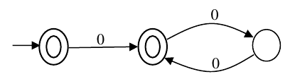

# 2018 CS Q62: Order of a language accepted by a three-state automaton

## Question

Given a language $L$, define $L^i$ as follows:

$$L^0 = \lbrace\varepsilon\rbrace,\qquad L^i = L^{i-1}\cdot L \quad\text{for all } i > 0$$

The order of a language $L$ is defined as the smallest $k$ such that $L^k = L^{k+1}$. Consider the language $L_1$ (over alphabet 0) accepted by the following automaton.

The order of $L_1$ is _____.

Answer

**2**

Solution

**Read the automaton.** Let the states be $s_0$ (start, accepting), $s_1$ (accepting) and $s_2$ (non-accepting). Transitions: $s_0\xrightarrow{0}s_1$, $s_1\xrightarrow{0}s_2$, $s_2\xrightarrow{0}s_1$.

**The language.** After reading $0^k$ the machine is in $s_0$ if $k=0$, in $s_1$ if $k$ is odd, in $s_2$ if $k\ge2$ is even. Accepting states: $s_0$, $s_1$. So

$$L_1 = \lbrace\varepsilon\rbrace\cup\lbrace 0^k : k\text{ odd}\rbrace$$

Think in lengths: $\lbrace 0, 1, 3, 5, 7, \ldots\rbrace$.

**Powers:**

| Power | Lengths in the language | Same as next? |
|---|---|---|
| $L^0$ | $\lbrace0\rbrace$ | no |
| $L^1$ | $\lbrace0,1,3,5,\ldots\rbrace$ | no ($2\notin L^1$ but $2\in L^2$) |
| $L^2$ | all lengths $0,1,2,3,\ldots$ | **yes**: $L^3$ is also all |
| $L^3$ | all lengths | yes |

Sums of two lengths from $\lbrace0,1,3,5,\ldots\rbrace$ give every non-negative integer ($0$, $1$, $2=1+1$, $3$, $4=1+3$, $\ldots$), and adding another factor from $L$ (which contains $\varepsilon$) cannot add anything new. So the smallest $k$ with $L^k=L^{k+1}$ is **2**.

**Code check:** computing the length sets up to 60 confirmed $L^0\ne L^1$, $L^1\ne L^2$, $L^2=L^3=L^4$.

**Key idea:** since $\varepsilon \in L$, the powers only grow, and they stop growing once the language is closed under one more concatenation.

