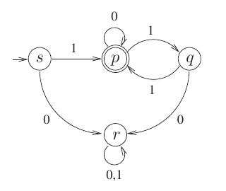

# 2023 CS Q14: Regular expression of a given DFA

## Question

Consider the Deterministic Finite-state Automaton (DFA) $\mathcal{A}$ shown below. The DFA runs on the alphabet $\lbrace 0, 1 \rbrace$, and has the set of states $\lbrace s, p, q, r \rbrace$, with $s$ being the start state and $p$ being the only final state.

Which one of the following regular expressions correctly describes the language accepted by $\mathcal{A}$?

- (A) $1(0^*11)^*$
- (B) $0(0+1)^*$
- (C) $1(0+11)^*$
- (D) $1(110^*)^*$

Answer

**C ($1(0+11)^*$)**

Solution

**Read the automaton.**

| State | on 0 | on 1 |
|---|---|---|
| $s$ (start) | $r$ | $p$ |
| $p$ (final) | $p$ | $q$ |
| $q$ | $r$ | $p$ |
| $r$ (dead) | $r$ | $r$ |

- The first symbol must be 1, since 0 sends us to the dead state $r$.
- From $p$ we can read 0 and stay in $p$, or read 1 to reach $q$.
- From $q$ only a second 1 returns to $p$. A 0 kills the run.

So after the leading 1 we repeat "0" or "11" any number of times: $1(0+11)^*$.

**Why the others fail:**
- **A** $1(0^*11)^*$ rejects $10$, which the DFA accepts.
- **B** starts with 0, but the DFA rejects every string starting with 0.
- **D** $1(110^*)^*$ rejects $10$, and it forces 0s to follow a $11$ pair.

**Code check:** comparing the DFA with each regex on all strings up to length 12 shows that only C matches.

**Key idea:** to get the regex, treat each loop back to a state as a repeatable unit: here the units are "0" and "11".

