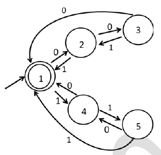

# 2024 CS1 Q50: Distinguishable states in a 5-state DFA

## Question

Consider the 5-state DFA $M$ accepting the language $L(M) \subset (0+1)^*$ shown below. For any string $w \in (0+1)^*$ let $n_0(w)$ be the number of 0's in $w$ and $n_1(w)$ be the number of 1's in $w$.

Which of the following statements is/are **FALSE**?

- (A) States 2 and 4 are distinguishable in $M$
- (B) States 3 and 4 are distinguishable in $M$
- (C) States 2 and 5 are distinguishable in $M$
- (D) Any string $w$ with $n_0(w) = n_1(w)$ is in $L(M)$

Answer

**B and C**

Solution

**Transition table** (read from the figure; accepting state is 1 only):

| State | on 0 | on 1 |
|---|---|---|
| 1 (start, accept) | 2 | 4 |
| 2 | 3 | 1 |
| 3 | 1 | 2 |
| 4 | 1 | 5 |
| 5 | 4 | 1 |

**Merge equivalent states (partition refinement).** Start with $\lbrace 1 \rbrace$ and $\lbrace 2,3,4,5 \rbrace$ (accepting vs not). Refine by where each state goes on 0 and 1:

| State | on 0 → block | on 1 → block |
|---|---|---|
| 2 | {2,3,4,5} | {1} |
| 3 | {1} | {2,3,4,5} |
| 4 | {1} | {2,3,4,5} |
| 5 | {2,3,4,5} | {1} |

So $\lbrace 2,5 \rbrace$ behave alike and $\lbrace 3,4 \rbrace$ behave alike. Next round confirms the classes **$\lbrace 1 \rbrace$, $\lbrace 2,5 \rbrace$, $\lbrace 3,4 \rbrace$**.

**What the DFA computes.** Each 0 adds +1 and each 1 adds −1 to $(n_0 - n_1) \bmod 3$. State 1 is residue 0, states 2 and 5 are residue 1, states 3 and 4 are residue 2. So $L(M) = \lbrace w : n_0(w) - n_1(w) \equiv 0 \pmod 3 \rbrace$. (A script confirmed this for all strings up to length 8.)

- **(A) True (not false).** 2 is residue 1, 4 is residue 2: distinguishable.
- **(B) False.** 3 and 4 are in the same class, so they are **not** distinguishable.
- **(C) False.** 2 and 5 are in the same class, so they are **not** distinguishable.
- **(D) True (not false).** If $n_0 = n_1$ the difference is 0, which is divisible by 3, so $w \in L(M)$.

**Key idea:** two states are distinguishable only if some string leads one to an accepting state and the other to a rejecting state. Here the DFA is just a mod-3 counter, so states with the same residue are equivalent.

