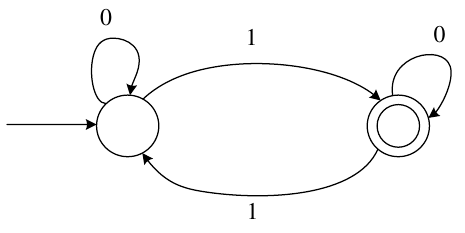

# 2024 CS2 Q22: Regular expression for a two-state DFA

## Question

Which one of the following regular expressions is equivalent to the language accepted by the DFA given below?

- (A) $0^*1(0 + 10^*1)^*$
- (B) $0^*(10^*11)^*0^*$
- (C) $0^*1(010^*1)^*0^*$
- (D) $0(1 + 0^*10^*1)^*0^*$

Answer

**A**

Solution

**What the DFA does.** Reading 0 never changes the state. Reading 1 toggles between the two states. The accepting state is reached after an **odd number of 1s**. So

$$L = \lbrace w : n_1(w) \text{ is odd} \rbrace.$$

**Check (A):** $0^*1(0 + 10^*1)^*$. The first 1 moves to the accepting state. Then each loop is either a 0 (stay) or $10^*1$ (leave, wander on 0s, come back with another 1). So the number of 1s is $1 + 2k$, always odd. ✓ A script checked all strings up to length 10.

**Why the others fail:**

- **(B)** accepts $\varepsilon$, which has zero 1s (even).
- **(C)** cannot produce $111$ (odd number of 1s), so it misses valid strings.
- **(D)** must start with 0, so it misses $1$.

**Key idea:** describe the DFA's language in words first (here: "odd number of 1s"), then test each expression against it.

