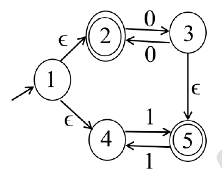

# 2024 CS2 Q41: Language of an NFA with epsilon moves

## Question

Let $M$ be the 5-state NFA with $\epsilon$-transitions shown in the diagram below.

Which one of the following regular expressions represents the language accepted by $M$?

- (A) $(00)^* + 1(11)^*$
- (B) $0^* + (1 + 0(00)^*)(11)^*$
- (C) $(00)^* + (1 + (00)^*)(11)^*$
- (D) $0^+ + 1(11)^* + 0(11)^*$

Answer

**B**

Solution

**Follow the two branches from state 1.**

1. **Via state 2 (accepting).** The 0-edges between 2 and 3 make the machine go 2 → 3 → 2 → ... Ending in 2 after an **even** number of 0s gives $(00)^*$. Ending in 3 after an **odd** number of 0s gives $0(00)^*$, and from 3 the $\epsilon$ move leads to 5 (accepting).
2. **From state 5**, the 1-edges between 5 and 4 let the machine read $11$ repeatedly and return to 5: $(11)^*$.
3. **Via state 4.** Reading a single 1 gets to 5, then $(11)^*$ more: $1(11)^*$.

Put together:

- ends in 2: $(00)^*$
- ends in 5 after the 0-branch: $0(00)^*(11)^*$
- ends in 5 after the 1-branch: $1(11)^*$

Since $0^* = (00)^* + 0(00)^*$ and $0(00)^*$ is the same as $0(00)^*(11)^*$ with no 11 pairs, this equals

$$0^* + \left(1 + 0(00)^*\right)(11)^*.$$

**Verified.** I simulated the NFA and tested all four expressions on every string up to length 8. Only (B) matched.

**Why the others fail:** (A) misses odd runs of 0s such as `0`. (C) accepts `11`. (D) misses `00011`.

**Key idea:** trace each path separately and note which accepting state it ends in.

