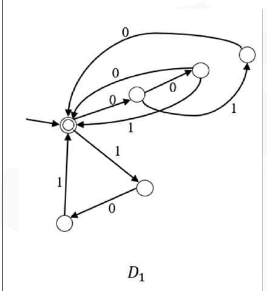
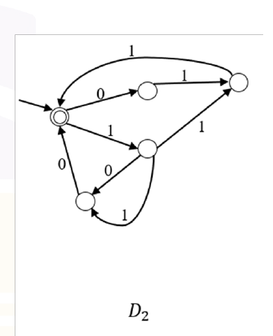
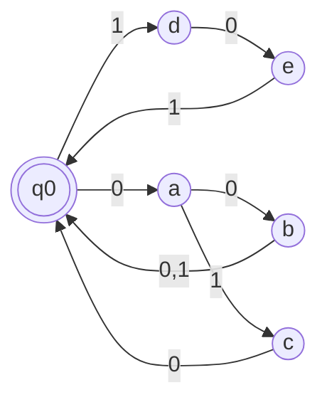
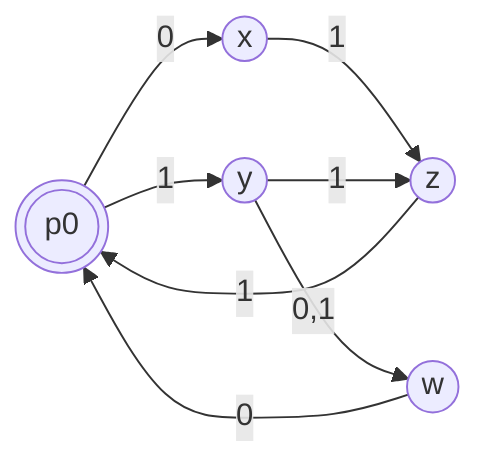

# 2026 CS2 Q47: Comparing two finite automata

## Question

Consider the following two finite automata $D_1$ and $D_2$.

Which of the following statements is/are true?

- (A) $L(D_1) = L(D_2)$
- (B) $L(D_1)$ is a proper subset of $L(D_2)$
- (C) $L(D_1) \cap L(D_2) = \lbrace \epsilon \rbrace$
- (D) $(L(D_1) \cup L(D_2))^*$ consists of all strings in $\lbrace 0,1 \rbrace^*$ whose length is divisible by 3

Answer

**C and D**

Solution

**Read the machines.** In both, the start state is the only accepting state, and every route back to it uses exactly 3 symbols. So each language is "blocks of length 3, repeated".

**$D_1$** (redrawn). Routes from $q_0$ back to $q_0$:

Blocks: $1\,0\,1$, $0\,0\,0$, $0\,0\,1$, $0\,1\,0$. So

$$L(D_1) = (101 \mid 000 \mid 001 \mid 010)^*.$$

**$D_2$** (redrawn):

Blocks: $0\,1\,1$, $1\,1\,1$, $1\,0\,0$, $1\,1\,0$. So

$$L(D_2) = (011 \mid 111 \mid 100 \mid 110)^*.$$

$D_2$ is nondeterministic at $y$ (two edges labelled 1).

**The two block sets are disjoint and together are all 8 strings of length 3:**

| $D_1$ | 000, 001, 010, 101 |
|---|---|
| $D_2$ | 011, 100, 110, 111 |

- **(A) false.** The languages are different (for example $000 \in L(D_1)$ only).
- **(B) false.** $L(D_1)$ is not inside $L(D_2)$.
- **(C) true.** A non-empty string in both would have a first 3-symbol block in both block sets, but the sets are disjoint. So only $\epsilon$ is common.
- **(D) true.** The union of the block sets is all of $\lbrace 0,1 \rbrace^3$, and starring it gives every string whose length is a multiple of 3.

**Verified.** I enumerated all strings up to length 12 with both automata: (A) and (B) fail, (C) and (D) hold.

**Key idea:** when every cycle through the start state has the same length, the language is "blocks of that length". Then compare the block sets.

